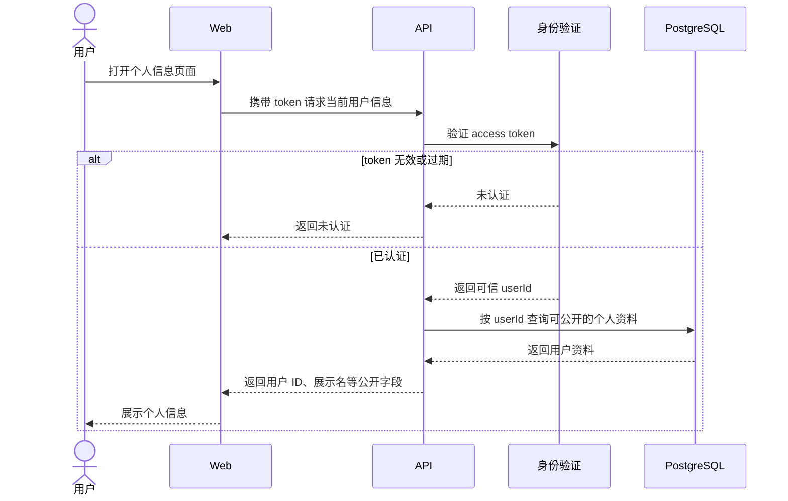

# 获取当前用户信息 PRD

层级：L3 功能级。状态：待评审。所属模块：[身份与用户](../modules/identity.md)。

## 目标与用户场景

用户登录后持有 access token，用它请求后端并获得自己的公开资料。该接口返回用户信息，不再次签发 token。

## 前置条件与输入输出

请求在 `Authorization: Bearer <token>` 中携带登录返回的 token，不传目标用户 ID。成功响应返回当前用户 ID、账号标识和展示名等公开字段。前端用这些字段展示当前账号。

## 业务规则与异常

API 验证 token，从服务端会话获取可信 `userId`，再按该 ID 查询 PostgreSQL。无效或过期 token 返回未认证；用户记录不存在时使该会话失效并返回未认证。响应不包含密码验证材料、token 会话内容或插件凭据。

## 时序图

## 验收标准

1. 使用登录返回的有效 token 可获取与该 token 对应的用户资料。
2. 改动请求参数不能读取其他用户资料；无效或过期 token 被拒绝。
3. 响应不包含密码验证材料、插件凭据或第二个 token。
