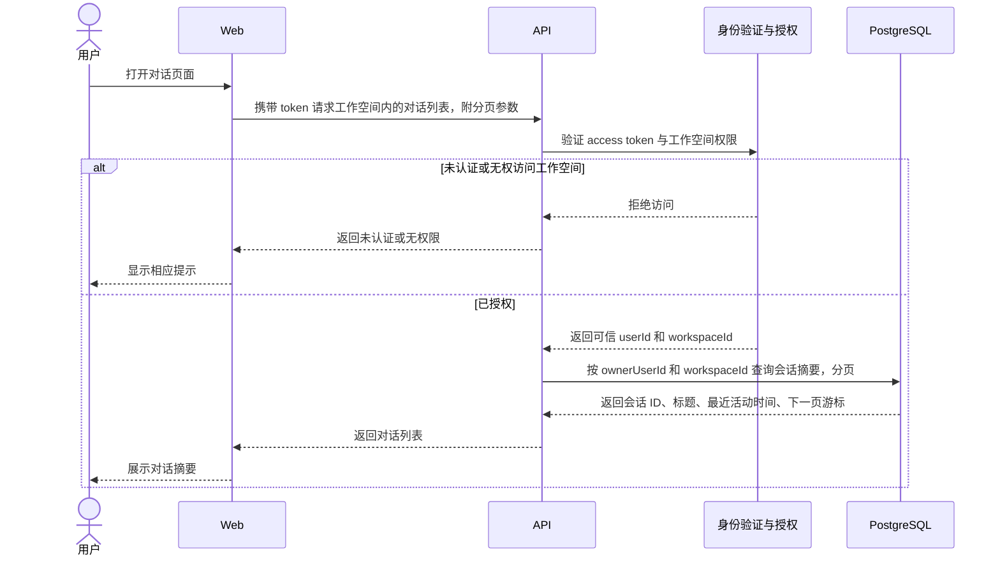

# 获取对话列表 PRD

层级：L3 功能级。状态：待评审。所属模块：[对话](../modules/conversations.md)。

## 目标与用户场景

用户打开某工作空间的对话页面，看到自己可访问的会话摘要并继续打开其中一条。首版列表限定当前用户和当前工作空间。

## 前置条件与输入输出

请求携带 access token、工作空间标识及分页游标。成功响应包含 `items` 与 `nextCursor`；每项至少包含会话 ID、标题和最近活动时间。首次请求可以不带游标，空列表返回空 `items`。

## 业务规则与异常

API 先验证 token，再验证当前用户对目标工作空间的访问权限。数据库查询同时限定 `ownerUserId` 和 `workspaceId`，按最近活动时间倒序，同时间用会话 ID 稳定排序。无效 token 返回未认证；无工作空间权限返回无权限；无效游标返回可修正错误。列表不返回完整事件或消息正文。

## 时序图

## 验收标准

1. 有效 token 和授权工作空间返回当前用户的会话，按最近活动时间分页。
2. 用户 A 的结果不包含用户 B 的会话；切换工作空间后查询范围随之改变。
3. 无效 token、无权限工作空间和无效游标得到相应错误。
4. 空列表与末页有明确表示，响应不包含完整消息正文。
