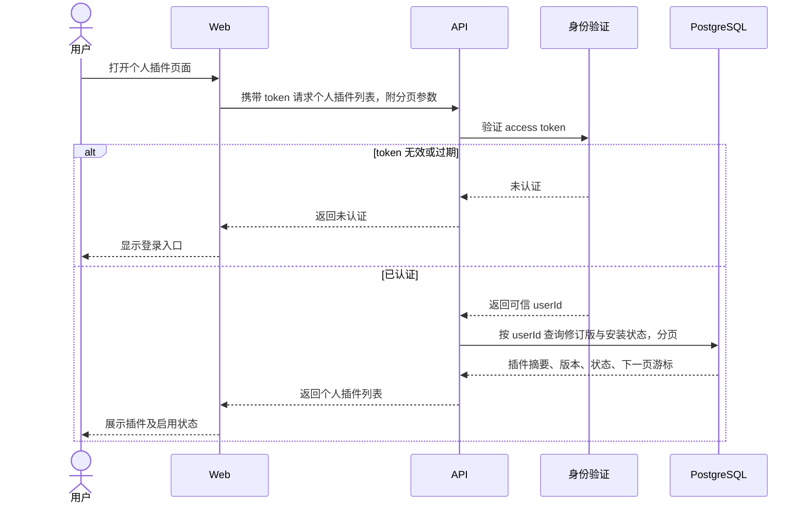

# 获取个人插件列表 PRD

层级：L3 功能级。状态：待评审。所属模块：[个人插件](../modules/plugins.md)。

## 目标与用户场景

已登录用户打开插件页面时，看到自己上传的插件修订版及启用状态，能继续管理个人插件。首版列表按用户归属展示，不展示其他用户或平台未授权的插件。

## 前置条件与输入输出

前置条件：客户端持有登录返回的 access token。请求携带 `Authorization: Bearer <token>` 和分页游标。响应包含 `items` 与 `nextCursor`；每项提供修订版 ID、名称、版本、上传时间和启用状态。首次请求可以不带游标，空列表返回空 `items`。

## 业务规则与异常

API 从 token 得到 `userId` 并据此查询，不接受客户端指定其他用户。列表按上传时间倒序，同时间用修订版 ID 稳定排序。无效或过期 token 返回未认证；分页参数无效返回可修正错误。响应只包含展示字段，不包含插件包、授权凭据和服务器内部路径。

## 时序图

## 验收标准

1. 用户 A 上传插件后，在自己的列表看到对应修订版，初始状态为未启用。
2. 用户 B 的列表不出现 A 的修订版；改变请求参数不能读取 A 的列表。
3. 分页游标可逐页遍历结果，空列表和末页有明确表示。
4. 无效或过期 token 被拒绝，响应不包含插件包或凭据。
