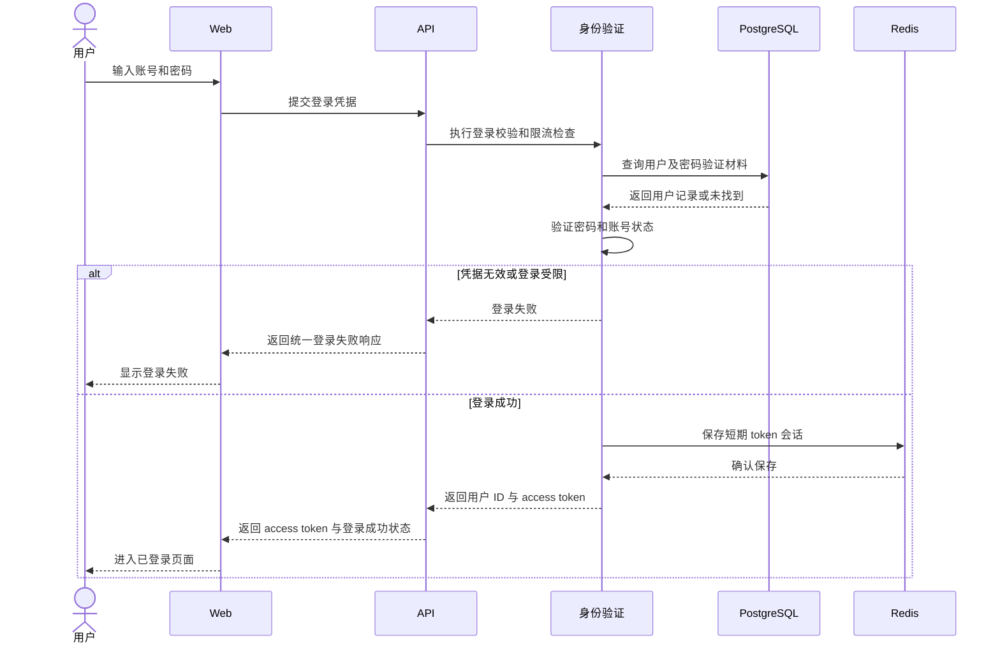

# 用户登录 PRD

层级：L3 功能级。状态：待评审。所属模块：[身份与用户](../modules/identity.md)。

## 目标与用户场景

已注册用户输入账号和密码。验证成功后，后端在响应中返回 access token；用户用该 token 请求个人信息、插件和对话等受保护接口。

## 前置条件与输入输出

输入为账号标识和密码。成功响应包含 `accessToken`、有效期信息和公开的用户 ID；token 作为 `Authorization: Bearer <token>` 发送到后续接口。首版使用服务端短期会话，Redis 存储 token 对应的会话状态。token 的具体长度和有效期在接口契约与安全配置中固化。

## 业务规则与异常

API 校验凭据并执行登录限流。账号不存在、密码错误或账号不能登录时返回统一失败响应；Redis 无法保存会话时不返回可用 token。token 只能由后端签发，过期或撤销后受保护接口拒绝它。客户端不能用请求中的用户 ID 替代 token 身份。

## 时序图

## 验收标准

1. 正确凭据返回 access token；客户端可用它访问自己的受保护接口。
2. 错误凭据返回统一失败状态，不暴露账号是否存在。
3. Redis 写入失败、token 过期或 token 被撤销时，后续接口不能以该 token 通过认证。
4. 登录响应不包含密码验证材料或平台密钥。
