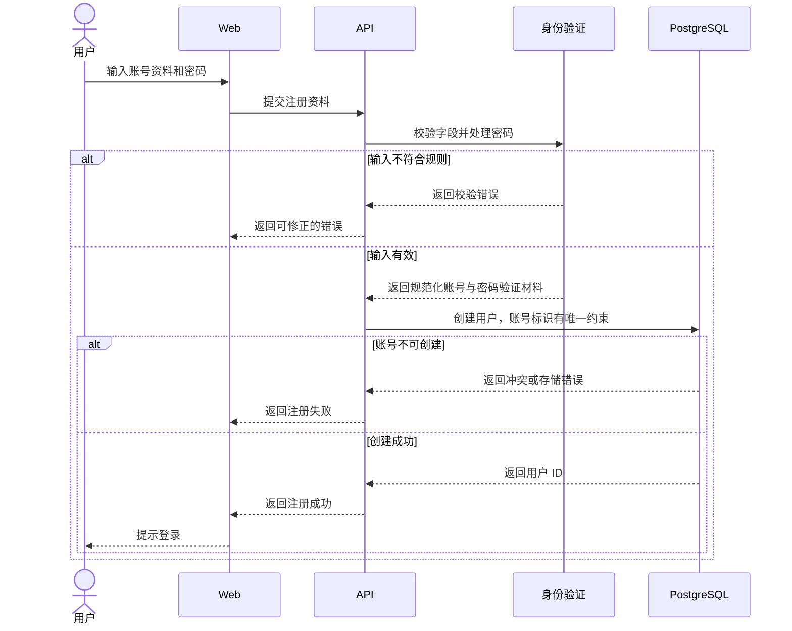

# 用户注册 PRD

层级：L3 功能级。状态：待评审。所属模块：[身份与用户](../modules/identity.md)。

## 目标与用户场景

新用户提交账号标识、展示名和密码，创建可用于登录的个人账号。注册完成后用户进入登录流程，注册接口不签发 token。

## 前置条件与输入输出

输入为账号标识、展示名和密码。首版账号标识按邮箱处理，这是本草案的产品假设。成功响应返回用户 ID 与注册成功状态；失败响应给出可修正的字段错误或账号冲突状态，不返回密码或密码验证材料。

## 业务规则与异常

API 校验字段并在服务端处理密码，PostgreSQL 对规范化账号标识设唯一约束。并发注册同一账号时只有一次成功。数据库写入失败不产生用户。注册成功不自动登录；登录失败和 token 过期处理见[用户登录](./login.md)。

## 时序图

## 验收标准

1. 合法资料创建唯一账号，随后可用该账号登录。
2. 字段无效有可修正反馈；同一账号并发注册至多产生一个用户。
3. 注册响应和日志不包含明文密码或密码验证材料。
4. 注册成功响应不包含 access token。
