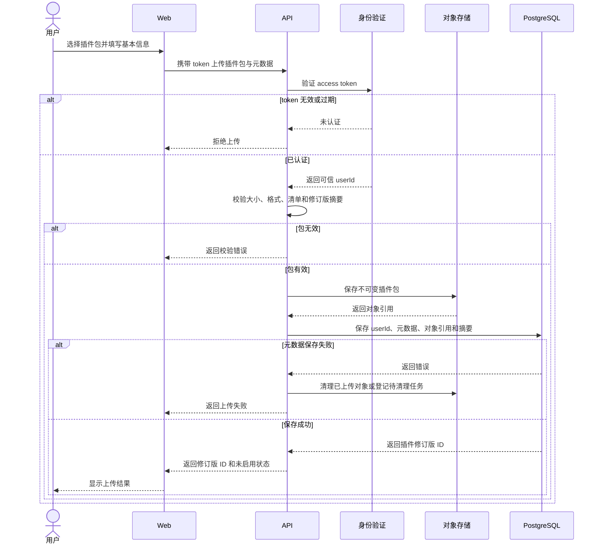

# 上传个人插件 PRD

层级：L3 功能级。状态：待评审。所属模块：[个人插件](../modules/plugins.md)。

## 目标与用户场景

已登录用户上传符合平台插件清单规范的代码包，得到一个归属于自己的不可变修订版。上传完成后可以在个人插件列表中查看；启用和执行由独立操作完成。

## 前置条件与输入输出

请求携带 access token、插件包及其清单。清单至少包含插件名称、版本和入口声明；具体清单字段在实现契约中固化。成功响应返回修订版 ID、摘要和未启用状态。原始包存对象存储，PostgreSQL 保存所属用户、元数据、对象引用和摘要。

## 业务规则与异常

API 从 token 得到用户身份。上传前校验大小上限、包格式、清单与入口声明；检验不得执行用户代码。每次成功上传生成不可变修订版。对象存储成功而数据库保存失败时，清理对象或登记可靠清理任务；不会返回可启用修订版。token 无效、包无效或存储失败均返回明确失败。文件大小上限由服务端配置，并在接口契约中公开。

## 时序图

## 验收标准

1. 合法插件包上传后产生可在本人列表查询的未启用修订版，摘要与保存对象一致。
2. 上传完成不会启动沙箱或执行插件代码。
3. 无效 token、超限或清单错误的包被拒绝，不产生修订版。
4. 数据库失败后的对象被清理或进入可追踪的清理任务；用户无法启用失败上传。
