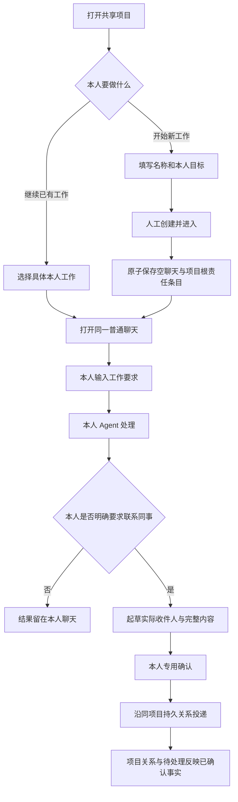

# SF-017：上下游责任关系与协作推进规格

## 元信息

| 字段     | 值                                            |
| -------- | --------------------------------------------- |
| ID       | SF-017                                        |
| 名称     | 项目内上下游责任关系、待处理及开始本人工作    |
| 状态     | Accepted — User Authorized Iterative Delivery |
| 创建日期 | 2026-10-20                                    |
| 最近更新 | 2026-10-20                                    |

## 背景与问题

Workspace 与 Project 两项已通过独立验收。现有底层可以交接、向上游补问和按原问题答复，但项目只平铺责任工作：用户看不出完整责任链、谁正在等谁、下一步轮到谁。`waiting-owner` 既可能是本人判断，也可能是发起者等待下游，直接翻译会误导。新建共享项目还没有“从这里开始本人工作”的入口，用户回到普通聊天 @ 同事又可能新建另一事项，项目与工作脱节。

本项在项目页呈现真实关系及待处理对象，并把新开始的本人普通聊天可靠地绑定到项目。工作与沟通继续发生在本人普通 Agent 聊天中，保留 SF-014 的本人外联意图、发送草稿与专用人工确认边界。

## 目标

- 有效项目成员可从项目概览分辨多条责任链、实际负责人，以及每一项等待的方向和处理人。
- 用户可在既有共享项目中显式新建本人工作，或逐项继续已有工作，随后协作沿原项目衔接。
- 展示协作进度只读取安全元数据，不向全项目公开问题正文、交接目标/上下文或私有聊天。

## 范围

### 范围内

- 协作项目概览里的“我的工作”“待处理”“协作关系”，含真实负责人、方向、状态与本人聊天链接。
- 由持久责任节点和问题派生安全的关系/进度投影，不新增平行的业务关系主记录。
- “开始我的工作”人工新建本人普通空聊天、根责任条目及持久绑定，首次本人输入后才执行。
- 新来源后续正常交接仍进入同项目；既有交接/回问/精确答复完整回归和真实三人链路验证。

### 范围外

- 节点拖拽/连线编辑、模板固定负责人、流程编排、Skills、看板、自定义状态或新的完成/审批状态机。
- 替他人新建本人工作、转派负责人、关联已有私有聊天的选择器、合并/迁移责任条目。
- 自动催办、自动向同事追问/答复、Agent 直接发送或发布成果、群聊和全量协作事件正文页。
- 普通聊天内项目/任务/上下游面板、额外回复表单、默认回复模式。
- 项目说明/notes 自动注入模型、共享私有目标或聊天历史、共享文件/RAG。

## 界面位置与流程

### 从项目开始本人工作

- 地址仍是 `/projects/[id]`。协作项目标题操作区增加主按钮“开始我的工作”，有效项目成员均可使用；原编辑/成员/刷新操作沿用现有层级。个人项目保持原功能，不增加此按钮。
- 默认 Dialog 的标题为“开始我的工作”，字段依次为“工作名称”（1–120 字）和“工作目标”（1–32000 字），均由本人明确输入，不预填项目说明或资料正文。说明“名称、负责人和协作进度对项目成员可见；目标供你与自己的 Agent 工作，不会自动发给同事”。
- 已有本人工作时，弹窗先提供它们各自的“继续我的聊天”，并用分隔明确“新建另一项工作”。原按钮始终表示显式新建，不自动取第一个节点，也不按名称猜测复用。多个同名工作展示短编号。
- 点击“创建并进入聊天”后原子保存一个新的本人普通 ChatConversation、一个无上游的本人责任条目、原项目绑定及创建动作；不生成 Task、user/assistant 开场消息、通知、job 或模型调用，不解密模型凭据或构造实际 provider 连接。
- 保存成功进入 `/?conversation=<真实本人聊天ID>`。查看空聊天仍零模型调用；本人第一次输入才走原 Cordis/本人模型路由。工作目标仅作为该本人工作的受信来源，项目说明和 notes 不自动带入；其他成员无私有目标和聊天权限。
- 同一创建动作失败重试只返回同聊天/条目；新动作明确新建第二项工作，即使名字相同。不复用完成、取消或撤权条目的旧授权。

### 项目概览的排列

- 保留 SF-016 的项目标题、成员、共享内容。将原“项目概览”平铺工作区改为“我的工作 → 待处理 → 协作关系”三段，仍在成员区之前，使用现有 Card/Badge/Button/Collapsible 默认样式，不另开图形工作台。
- “我的工作”只列本人的明确条目，每项名称、短编号、真实状态与对应聊天链接；多项逐项选择。旧取消/完成工作可在“已结束的工作”中查看本人既有聊天，文案“查看我的聊天”，不把只读查看当作恢复执行；撤权条目没有继续执行入口。
- “待处理”显示当前所有合法 pending 依赖，按创建时间从早到晚排列；区分“待我处理”“我在等待”“其他协作”。可以有多项和多个对象，逐项列出，不能用一条节点状态覆盖其他等待。统计是协作请求数，不是待办任务数或项目完成率。
- 每项只显示请求方工作名称/负责人、应处理方工作名称/负责人、等待类型、发起时间。例：“Sales 的客户反馈整理，正在等待 Product 处理协作请求”；反向例：“Product 的需求评估，正在等待 Sales 补充信息”。本人为处理方时有“去我的聊天处理”；本人为请求方时可“查看我的聊天”；其他成员只读关系，不得链接他人私有来源或看到问题正文。
- 自问自答依赖显示“等待张三本人判断”，不能误显示为上下游。已回答、拒绝、取消、到期及关联撤权条目的依赖不出现在待处理；没有合法 pending 时显示“当前没有待处理的协作请求”，不宣称项目完成。
- “协作关系”以根条目起始的纵向责任链展示：每项工作名称、负责人、短编号、公开状态和明确上游；下游接续在其下。多个根分别展示，同一根的多分支全部保留；不按负责人去重，防止同一人负责多个工作时丢关系。390px 采用不随深度持续增加宽度的纵向排列，不能要求横向拖动画布。
- 关系中的等待优先写出实际对象：“等待李四补充信息”“等待王五处理”；无 pending 的可工作状态称“可继续”，模型一次回复结束不等于业务完成。运行/失败/取消/完成按已有真实记录显示，撤权明确“授权已撤销”，不能被一般“可继续”掩盖。
- 当前可见节点的上游缺失或不可见时显示“原上游当前不可用”，不猜来源、不泄露隐藏标题。旧数据环或无效引用进入“关系待整理”组，节点最多显示一次，页面仍可读、可刷新，不递归死循环或伪造修复关系。
- 沿用原项目自动读取与“刷新项目”。收到/答复/取消后下次成功读取更新关系和待处理；失权清理旧投影，故障明确显示未能刷新，不把旧快照说成当前已确认状态。

## 共享范围与判定规则

安全关系/进度投影采用字段白名单：项目/工作稳定 ID、公开工作名称、实际负责人 ID/姓名、上游引用、公开状态、时间，以及合法 pending 的请求方/处理方节点、等待类型和版本身份。它不包含 `goal`、`context`、问题/答案正文、私有 source ID、journal、prompt、模型配置。只有本人条目的授权投影可带进入本人聊天的安全链接；未加入项目或失去 Workspace 资格仍执行原拒绝。

| 持久事实                                  | 显示的方向与对象                   | 本人处理入口               |
| ----------------------------------------- | ---------------------------------- | -------------------------- |
| 请求方节点和处理方节点相同                | 等待该负责人本人判断               | 仅该负责人可进入本人聊天   |
| 请求方的上游就是处理方                    | 请求方等待该上游负责人补充信息     | 仅目标上游负责人可去处理   |
| 处理方的上游就是请求方                    | 请求方等待该下游负责人处理协作请求 | 仅目标下游负责人可去处理   |
| 多个合法 pending 关联同一节点             | 每项分别列方向、对象、时间         | 各项按真实目标分别授权     |
| pending 终结、节点撤权/取消或无法有效授权 | 不列为可推进的待处理               | 不恢复旧执行/草稿          |
| 历史无效引用或无法分类的旧关系            | 安全标记关系待整理，不猜处理方     | 仅保留已有本人合法查看权限 |

问题全文和答案继续只由原相关人通过原 node/source 授权读取；即使 project owner 也不因总览获得全文。协作关系可见性不等于对外发送授权。后续 @ 同事仍由本人发起、Agent 起草、本人专用确认，再按当前项目/工作空间和来源权限投递。

## 功能需求

| ID      | 需求                                                                                                                                                                                                                                                  | 优先级 |
| ------- | ----------------------------------------------------------------------------------------------------------------------------------------------------------------------------------------------------------------------------------------------------- | ------ |
| REQ-001 | 在协作项目标题区和概览提供上述开始、本人工作、待处理及协作关系入口；个人项目和 SF-016 成员/共享资料功能不改变。普通聊天继续只使用原输入器和真实本人发送确认，无新增协作面板。                                                                         | Must   |
| REQ-002 | 有效项目成员人工输入名称 1–120、目标 1–32000 创建本人工作，原子保存本人普通空聊天、项目根责任条目、bound 来源和幂等动作。创建者及所属项目从真实授权确定，不可指定他人；准备非秘密默认 Agent 路由但不解密凭据、不调用模型，不创建 Task/消息/通知/job。 | Must   |
| REQ-003 | 新建与继续分离，已有本人工作逐项进入精确来源，多同名以稳定短编号消歧；同 requestId 同内容仅一份、异内容冲突，新 requestId 可明确创建另一份。取消/完成/撤权旧工作不被自动复用或复活。失败保留输入，版本冲突先重读再人工提交。                          | Must   |
| REQ-004 | 新本人来源在普通聊天的第一次本人输入才运行，按原本人模型目录/路由及 Cordis 仲裁执行；显式工作目标可用于该本人工作，但项目说明/notes 和他人私聊不自动注入。随后确认的正常交接继承所绑定 Project 和真实上游，不另建项目、不迁移私人所有权。             | Must   |
| REQ-005 | 在现有持久节点和问题上派生独立安全关系/进度投影，按上述字段白名单和双重成员权限返回；项目总览不能通过复用完整 node/question 响应扩大 goal/context、问题/答案正文、私有 source 或凭据可见性。本人工作链接只给真实来源负责人。                          | Must   |
| REQ-006 | 待处理从当前合法 pending 问题逐项派生真实请求方/处理方与方向，支持同节点多个等待和多个对象；下游处理、向上游补信息、本人判断区分。不可仅按 node.status 猜唯一目标；终结/过期/撤权/不可推进依赖不列待办，无依赖不冒称项目完成。                        | Must   |
| REQ-007 | 责任视图保留每个有效或历史条目的稳定身份及完整可见上下游，支持多根、多分支、同人多工作和重名负责人。旧取消/完成/撤权明确标识，失效上游不猜；无效引用/环有限遍历、单节点最多展示一次并有安全异常组，不改写原关系。                                     | Must   |
| REQ-008 | 项目视图沿原自动读取和手动刷新反映已提交交接、问题、答复和撤销，失权清除旧投影。三人原聊天往返继续真实原问题/版本、草稿确认、来源、同 session 和幂等；本人普通分析/“确认”等讨论不能自动外联、发布资料或完成工作。                                     | Must   |
| REQ-009 | 本人工作创建命令仅真实人工可用，Agent/worker 无该命令能力；所有新记录及幂等用 PostgreSQL，正常故障无内存降级。创建/进度读取和撤权竞争在服务器授权及版本/事务边界复验，重启保原聊天、根节点及关系，不留下半条目或重复来源。                            | Must   |
| REQ-010 | 沿用官方 shadcn/ui Base Nova/Neutral、账户与私有 Portal 边界；桌面和实际 390px 关系/待处理/新建可用，长名/深链不横溢，键盘焦点与错误反馈正确。同步 UI/所有权文档，执行适用工程及旧功能回归，逐 AC 如实记录证据。                                      | Must   |

## 验收标准

| ID     | 关联需求                  | 前置条件                                                                                  | 操作                                                                                                                  | 预期结果                                                                                                                                                                              |
| ------ | ------------------------- | ----------------------------------------------------------------------------------------- | --------------------------------------------------------------------------------------------------------------------- | ------------------------------------------------------------------------------------------------------------------------------------------------------------------------------------- |
| AC-001 | REQ-001、REQ-002、REQ-009 | A 为共享项目成员，项目无工作；B 非成员。                                                  | A 打开开始弹窗并创建合法工作，B 猜项目/命令或指定其他 owner；检查持久记录/模型请求。                                  | A 只生成一个本人普通空聊天、根条目、bound 来源及动作；无 Task、开场/用户消息、job、通知或模型请求；B/伪造 owner 拒绝，目标不自动分享。                                                |
| AC-002 | REQ-002、REQ-003、REQ-010 | 真实表单，边界标题/目标、可控失败。                                                       | 测试空白、120/121 名称、32000/32001 目标；保存后丢响应并发重试、同 ID 改内容，再新动作新建同名工作。                  | 前后端拒绝非法值；失败保稿，原动作仅同一聊天/节点，异内容冲突；新动作明确第二份，名称/ID可区分，无自动复用。                                                                          |
| AC-003 | REQ-003、REQ-007          | A 在同项目有多份工作和同名工作，含完成、取消、撤权历史；B 同名。                          | 打开我的工作及开始弹窗，逐项选择继续/查看，再创建新工作。                                                             | 每项准确对应原来源，显示负责人/短编号，历史状态明确；撤权无继续执行，完成/取消查看不恢复授权；不暗选数组第一项或按名字混淆。                                                          |
| AC-004 | REQ-002、REQ-004、REQ-009 | 项目说明/notes 含独有敏感标记，A 有本人路由，可记录 provider 输入。                       | 创建/查看空聊天，再首次输入要求；后续明确 @B 并确认完整草稿。                                                         | 前两步零模型/凭据解密，首次输入才本人路由运行；仅显式工作目标进入本人上下文，说明/notes不自动注入；交接保同 Project 和真实上游，不另建项目或复制私人上下文。                          |
| AC-005 | REQ-005、REQ-007          | 三人项目有 A→B→C、另一个根和分支，节点 goal/context/问题/答案各含秘密标记，D 非项目成员。 | A/B/C 查看进度 API/页面，D 猜读取；尝试开他人来源。                                                                   | 完整可见元数据关系正确；进度白名单无秘密全文、私有 source/prompt/key；仅本人链接有效，D 拒绝，project owner不获得额外正文权限。                                                       |
| AC-006 | REQ-005、REQ-006          | 分别存在上游等下游处理、下游向上游补问、自我判断的 pending。                              | 对照持久 nodeId/targetNodeId/upstreamNodeId 读取待处理并以双方身份查看。                                              | 方向和真实应处理人逐项正确，waiting-owner不误认；仅实际处理人有去本人聊天处理入口，请求人只能开自己来源，第三方只读安全关系。                                                         |
| AC-007 | REQ-006、REQ-008          | 同节点关联多项入站/出站 pending，目标多人，含不同 Project。                               | 读取和切换“待我处理/我在等待/其他协作”，终结其中一项后刷新。                                                          | 各项独立且只属本 Project，一项状态不覆盖其他对象；计数按合法请求，不丢多等待、不跨事项混合。                                                                                          |
| AC-008 | REQ-006、REQ-007、REQ-008 | pending 可分别回答、拒绝、取消、到期或来源撤权，节点可为 ready/waiting-owner/failed。     | 终结各等待，再自动/手动刷新；读取无 pending 的状态。                                                                  | 相应项退出待处理，不复活旧问题/草稿；工作保持真实执行状态，generic等待不伪造对象，无等待不等于完成项目。                                                                              |
| AC-009 | REQ-007、REQ-010          | 关系 fixture 含多根、多分支、同人多节点、同名、失效上游引用和历史环。                     | 打开桌面/390px关系视图并键盘浏览。                                                                                    | 根/分支/负责人不混，每节点最多一次；失效上游不猜，环进入关系待整理且页面不挂；深链不不断缩窄或横向溢出，不写回修复历史。                                                              |
| AC-010 | REQ-004、REQ-006、REQ-008 | 真实 A/B/C 账户、同共享项目、受控 provider 与真实 PG。                                    | A开始本人工作→明确请B评估并确认→B正常聊天先分析、明确向A补问并确认→A明确答复并确认→B继续并明确交C评估确认；观察项目。 | 同一Project的A→B→C关系及反向等待真实可见，问题回到A原聊天、答复回B同session；各人普通聊天无协作面板，查看零模型，私人讨论不自动发，所有外联先完整草稿和本人专用确认，重复确认不重投。 |
| AC-011 | REQ-005、REQ-008、REQ-009 | 有旧进度页、新建表单、pending和在途响应，owner可撤Project/Workspace权限。                 | 撤权后重读/重试开始/旧确认，再重加并回放旧动作；故障重试。                                                            | 授权失效拒绝且清旧投影，成员 ID 残留不能绕过；重加不复活旧节点/grant/job/草稿，旧私有历史保留，故障不假空态/成功。                                                                    |
| AC-012 | REQ-002、REQ-003、REQ-009 | PostgreSQL 已保存根工作/绑定/动作/责任链和等待。                                          | 独立 API 进程重启，读取同聊天与进度、重放原开始动作；模拟事务失败。                                                   | 稳定 ID/绑定/链/等待恢复，重试无重复；失败不留空聊天或半节点，无内存降级，查看仍不触发模型。                                                                                          |
| AC-013 | REQ-001、REQ-003、REQ-010 | 桌面和真实 390px、键盘、长标题/错误/未保存表单。                                          | 实际完成开始、取消、继续多工作、待处理跳转、关系刷新，检查普通聊天。                                                  | 原样式/导航一致，无横溢，Dialog焦点/首错/取消正确、失败保稿、防重复；普通聊天仍原输入器和草稿确认，未新增任务/项目/上下游面板。                                                       |
| AC-014 | REQ-008、REQ-009、REQ-010 | 新实现与 Workspace/Project/个人任务/模板/旧协作回归。                                     | 运行适用单元/API/真实PG/独立进程/UI、types、server/Web生产构建、lint/format；检查UI和AGENTS边界。                     | 新旧权限/普通聊天/发送审稿/模板兼容，测试不进生产产物，所有AC有真实证据；受控provider与真实云模型的证据界限如实说明。                                                                 |

## 非功能约束

- 沿用 AGENTS 及 SF-015/016 的真实身份、双重权限、持久化和私有内容边界。安全进度是派生只读视图，原问题/节点/动作仍是事实主记录，不引入第二套状态机。
- 旧复杂图数据处理有限且可预测；关系展示不能依赖对用户机器执行脚本或模型总结，负责人/状态不靠模型生成。
- 新建准备非秘密 Agent 快照与执行连接解析分开；读取个人路由元信息不等于解密 provider key，系统模型不可用时明确提示实际执行缺配置，不以创建成功宣称已执行。
- 函数注释、同级测试和工程门沿用仓库约定，不在 Spec 重复已验收的全部通用规则。

## 依赖与假设

- 主 agent 已确认 SF-016 Accepted；本项为用户规定的第三轮，需求提出后主 agent 实施、独立测试验收，通过后才开始第四项。
- 用户已授权该轮转，无额外文档审批。具体接口名和内部结构由主 agent决定，可在现有 collaboration 命令增加真实人工开始动作，并扩展安全进度响应。
- “开始我的工作”每次明确创建新根，继续通过已有各条目链接选择；不附带替别人指派节点的隐藏流程。
- 既有单上游模型可表示多根和分支；回问只是信息依赖，不改变责任树、不制造环形执行或自动循环外联。

## 未决问题

- 无产品阻塞；若新发现改变安全可见范围或用户流程，先更新本规格及 AC 后实施，不将缺失能力写成已交付。
