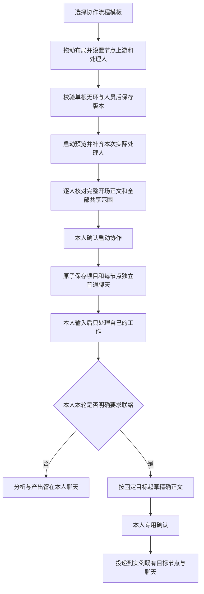

# SF-018：可视协作任务模板规格

## 元信息

| 字段     | 值                                       |
| -------- | ---------------------------------------- |
| ID       | SF-018                                   |
| 名称     | 节点拖拽、固定处理人与上下游协作任务模板 |
| 状态     | Accepted                                 |
| 创建日期 | 2026-10-20                               |
| 最近更新 | 2026-10-20                               |

## 本次用户反馈修订（2026-10-20）

初版已按 AC-001–AC-018 独立验收为 Accepted；下文初版 REQ/AC 及 changes 中的 PASS 证据保留为历史。用户此前明确要求任务模板界面**只保留协作流程**，并以 **React Flow** 完成图形编辑和拖拽。REQ-013–REQ-015 / AC-019–AC-021 取代初版中“双类型页面、默认个人清单、自研画布与不要求连线编辑”的界面约定，后续入口、结构边界及弹窗进一步由 REQ-016–REQ-018 覆盖；其他数据、启动和权限边界继续适用。用户已授权直接实施和独立测试，无新增审批。

### 本轮节点入口修订（2026-10-20）

上一轮 AC-019–AC-021 已独立验收；本轮用户要求删除“完整节点列表”，并询问如何创建节点。新增 REQ-016 / AC-022 覆盖原图/列表切换和隐藏在属性底部的“添加下游节点”入口：只保留 React Flow 画布，将唯一“添加节点（n/8）”入口放在画布上方；新增节点默认属于当前选中节点的下游，添加后立即选中并在画布中露出，再在属性区编辑。原生节点键盘选择、方向移动辅助、上游选择及既有数据、保存和人工启动边界继续适用。用户反馈已明确授权该小修订，直接实施并独立验收，不新增审批。

上一轮 AC-022 已独立验收为 PASS：适用 Web 回归 8 个测试集 50 项、实际桌面/390px与键盘、保存重读/只读预览、隔离 PostgreSQL 审计及工程检查均通过，测试环境已清理。AC-001–AC-022 的分阶段历史证据保留，详见 `changes.md`。

### 本轮开始/结束与节点弹窗修订（2026-10-20）

用户现明确要求默认提供开始节点、结束节点，并让节点编辑表单通过弹窗出现，避免画布下方的表单撑高页面。新增 REQ-017–REQ-018 / AC-023–AC-024：开始/结束是每张图自动提供的两个结构节点，不是需要处理人的工作，不占原2–8工作节点名额，不进入业务保存或启动映射；旧模板也按原关系补充这两个可视边界。工作节点的属性统一通过弹窗编辑，不再常驻画布下方或旁边；新增后自动打开弹窗，关闭保留未保存草稿，最终仍须“保存模板”。本轮已独立验收为 Accepted：AC-023–AC-024 PASS，8个适用 Web 测试集55项、实际桌面/390px与键盘、隔离PG只读审计、工程检查及环境清理均通过；沿既有需求→实现→独立测试授权交付，无新增审批。

## 背景与目标

SF-017 的项目责任关系及普通聊天协作已验收。当前任务模板仍是 SF-004 的个人有序清单：不能拖动节点布局、设置上下游或固定同事，重复流程仍须每次重新 @。本项在现有“任务模板”中增加协作流程，保存真实负责人和明确关系，启动后沿既有项目/普通聊天开展工作。

目标是让用户能画出并复用“销售整理 → 产品判断 → 工程评估”等流程，启动前完整审阅人员和实际开场正文，之后明确要求“交给下游”“问上游”时无需再次选人。固定关系是收件目标的约定，不能代替本人本轮联络意图或专用发送确认。

## 范围

### 范围内

- 唯一 `/templates` 入口只展示、新建、编辑和启动本人所有、当前 Workspace 范围的协作流程模板；历史个人清单数据和 API 保留，界面不再提供个人清单操作。
- 使用 React Flow 编辑 2–8 个稳定工作节点，默认展示一个开始和一个结束结构节点：拖拽工作节点布局、显式连接/重连单上游、弹窗编辑属性、真实处理人、版本保存和键盘/移动等价操作。
- 启动完整人工预览，原子实例化一个共享 Project、固定责任条目、每节点独立普通聊天与来源、模板版本快照及幂等记录。
- 本人明确联络后按实例固定上下游起草，确认后复用目标节点/聊天投递，支持原问题往返。
- 失效处理人替换、版本冲突、重启/丢响应重试与撤权回归。

### 范围外

- 模板市场、团队模板共享/共同编辑、导入导出、删除/归档、历史个人清单数据删除/转换及新增个人清单界面。
- 自动发起交接、自动逐节点执行、条件分支/表达式、并行调度器、审批门禁或新状态机。
- 一次指令向多个下游广播；有分支时本期一次明确处理一个目标。
- 云环境 setup/script/secrets、设备、共享文件、Skills 和看板。
- 在模板中选取其他人的私人 Agent、提示词、模型连接或密钥；普通聊天内流程编辑/项目面板。

## 界面位置与编辑方式

- 侧栏和移动 Sheet 仍叫“任务模板”，地址 `/templates`。目录只含协作流程，保留名称/说明搜索、稳定编号、版本与更新时间；不再显示“全部 / 个人清单 / 协作流程”类型筛选，不出现个人清单卡片或个人清单新建入口。计数、搜索与空态仅以协作流程为准，即使账户只有历史个人模板也显示协作流程空态。
- “新建模板”直接进入 `/templates/new` 的协作编辑器，不先选类型，旧 `kind=personal` 等查询参数也不能恢复个人新建。协作模板保存后仍为 `/templates/[id]`；类型不可静默转换。模板由本人维护和启动，不因指定别人为处理人开放模板编辑权。
- 历史个人模板原数据、版本、幂等与 API 保持，不删除、不迁移成协作流程。旧个人模板深链先按真实本人/当前 Workspace 读取授权目录元信息；只显示“当前任务模板仅支持协作流程，历史个人模板数据已保留”及“返回任务模板”，不展示完整任务目标、编辑/启动表单或个人清单操作。不存在、跨人/跨空间或读取失败保持原安全错误，不借类型提示泄露记录存在性。已有个人项目/Task 与冻结快照继续按原规则使用。
- 协作编辑页顶部是名称（1–120 字）、说明（0–2000 字）、版本/保存状态、“保存模板”和“启动预览”。中部只放 React Flow 画布及其工具栏，不再常驻节点属性表单或因编辑节点而增加页面高度；画布是唯一节点视图，不再显示“流程画布 / 完整节点列表”切换或独立节点列表。沿用现有 shadcn 默认组件、颜色变量和布局，不引入另一套应用主题。
- 必须实际使用 React Flow 的节点、边、选择、连接及拖动交互，不以原手写 pointer/SVG/绝对定位画布套一个库容器冒充替换。节点显示名称、真实处理人/未设置、稳定短编号和选中状态，上游输出 Handle 指向下游输入 Handle。节点拖动只改布局，不改负责人、业务节点 ID、工作说明或上下游；拖动后进入未保存草稿。
- 单击工作节点正文或选中后点击显式“编辑节点”动作，打开同一节点属性 Dialog，编辑“节点名称”（1–120 字）、“工作说明”（1–8000 字，全部节点合计最多 32000）、“处理人”“上游节点”。处理人从当前有效 Workspace 成员搜索选择，姓名与短编号消歧；不显示他人私有 Agent 选择。原生 React Flow 节点选择与弹窗使用同一属性草稿；拖动节点、点击连接 Handle、连线/重连、平移与缩放不能误开弹窗。
- 可从上游输出端连接到下游输入端，或重连边端点，显式修改目标节点唯一 `upstreamNodeId`；连接到已有上游的目标时替换该唯一上游，不保留第二条入边。属性中的“上游节点”与图边双向同步，支持“起点（无上游）”。删除一条边只清除对应目标的上游，不猜测新父节点；删除节点保留对受影响下游的明确待修复提示，不静默重连。自引用/环连接拒绝并保留原图；暂时断开或多起点草稿可以继续编辑，但前后端均禁止保存/启动，直到恰好单根、全部连通、无自引用/环。
- 名称/说明下方、画布上方放置唯一“添加节点（n/8）”按钮，并就近说明“新节点默认作为当前选中工作节点的下游”。不要求先滚动到属性底部或打开菜单才能发现创建方式；弹窗不再重复放置新增按钮。点击即生成新的稳定 ID 和布局位置，将当前选中工作节点设为其唯一上游，选中新节点并让画布露出它，同时打开新节点属性弹窗并聚焦名称，可直接编辑名称、工作说明、处理人和上游。原工作节点 ID、位置、关系、人员及正文不因新增改变；不自动保存或启动。最多 8 个、至少 2 个工作节点，开始/结束不计入名额；达到上限或 busy 时新增按钮禁用，删除下限和影响提示保持。
- 每张编辑图与只读预览图默认各有一个明确命名为“开始”“结束”的结构节点，使用与工作节点可辨的简洁样式，并说明它们无需处理人。“开始”投影连接到业务图中 `upstreamNodeId=null` 的工作节点，各末叶工作节点投影连接到同一个“结束”；对多根或断连草稿如实呈现，不以视觉开始节点掩盖原单根/连通校验错误。开始/结束及其边不可编辑、拖动、连线/重连或删除，也不出现在处理人/上游选择及工作节点计数中。
- 开始/结束由现有业务图在 Web 中派生，不创建持久业务 ID、说明、处理人、独立普通聊天/source、责任条目或项目成员，不进入创建/更新 payload、服务器 preview 节点和启动映射；它们不是调度器或新的固定联络目标。新建仍保留原2个工作节点，并额外显示开始→原工作节点关系→结束。旧模板载入自动补充边界，原节点 ID、坐标、上游、人员、正文、版本与实例均保持；仅查看这两个结构节点不写版本。
- 节点弹窗沿用现有 Dialog、表单、人员搜索及删除确认。弹窗明确标识当前节点，输入即时更新同一未保存模板草稿；“完成”、关闭按钮、Escape 或点击外部关闭都保留已输入内容，并提示仍需保存模板，不自动保存/启动或默默丢弃。重新打开同一节点恢复内容；选中其他节点后编辑不得串稿。删除仍是专用确认，2工作节点下限与下游待修复提示保持。
- 弹窗打开时焦点进入标题字段或明确错误字段，Tab 不离开当前弹窗，关闭后焦点回到发起控件。模板保存校验定位到有错工作节点时自动打开该节点弹窗并显示对应错误；busy 时按既有约束禁止修改或重复提交，保存冲突/失败不得丢失任何节点草稿。390px 弹窗在视口内纵向滚动、Footer“完成”及删除操作可达且无横向溢出；编辑弹窗不同时开启启动预览，启动预览中的节点保持只读，点击不会开启编辑弹窗。
- 布局位置与边关系独立，不能根据坐标、拖动先后或呈现顺序自动改边。必须保留服务器的字段/人员及单根无环完整图校验，React Flow 不能成为另一份业务主记录。
- 现有合法模板载入 React Flow 时保留原节点身份、位置、上游、人员及正文，不因换图工具重排、生成新业务 ID 或改已启动实例。坐标与画布位置可适配，但保存/重读应恢复同一布局；仅浏览、缩放、平移或适应视图不修改模板版本、不视为工作关系修改。保存失败/版本冲突保留全部位置、选中项、上游、人员与正文；显式重读不能无提示覆盖草稿。
- 键盘用户可聚焦并选择 React Flow 原生节点，通过原生方向键或方向移动控件调整布局、通过属性中的上游选择完成关系编辑；移除列表不能丢失这些操作。触屏可拖节点，输入和页面纵向滚动保持可用。React Flow 的平移/缩放/适应视图在画布容器内，390px 页面无横向溢出；新增和方向移动等触屏控件至少 44px，关键操作可通过键盘触达，不要求精确拖拽或连接 Handle 才能完成配置。未保存图不能启动，启动预览中的关系图为只读，不显示可用新增入口，也不能改变冻结的已审阅内容。

## 启动流程与完整共享预览

1. 只能启动已保存版本，未保存的布局、人员或正文修改同样阻止启动。预览填写新项目名/说明，展示模板 ID/版本和完整关系图。
2. 每个节点显示稳定编号、名称、完整工作说明、实际处理人及上下游。默认使用保存的真实处理人，可在本次预览替换为当前有效 Workspace 成员；这只改变本次实例，不自动修改模板。缺失/已退出处理人保留可辨认的失效提示，不猜人、不静默替换；补齐后重新检查完整预览。
3. 最终预览逐节点展示实际收件人，以及即将写入其普通聊天的**完整开场正文**：真实发起人、模板/项目/节点前缀、该节点工作说明、上下游人员说明等实际发送文字均须可见，不得只显示抽象 goal 再后台附加隐藏正文。启动者本人的节点明确“创建本人空聊天，不发送开场”。
4. 同时完整列出新项目的所有实际成员：启动者作为项目拥有者，加上处理人去重后的成员；解释这些人可见名称、责任关系、进度与以后明确发布的项目资料，各节点的目标/开场按该节点与原上下游授权提供，私人聊天和个人配置不作为全项目内容。
5. 点击“确认启动协作”是本人对本次已预览创建/共享的明确人工提交。服务器核验模板版本、实际人员和预览内容，按已审阅的精确内容保存；版本/人员/正文变更不得静默换用新预览提交。
6. 同事务生成一个共享 Project、每节点一个固定责任条目和一个独立普通聊天/source、模板版本与处理人映射快照、启动幂等记录。启动者节点是空聊天；其他人仅收到真实发起人来源的 assistant opening，作为同事参考，不伪造收件人 user 输入或 Agent/journal 已有承诺。新聊天进入各自普通聊天列表；不创建 Task、job、模型请求、凭据解密或独立通知。
7. 启动者可以不负责任何节点，根处理人也不必是启动者；不得为了项目 owner 插入隐藏节点/第二根。成功进入新项目，只有本人的工作显示本人聊天链接。即使同一人负责多个节点，每节点也必须分别有聊天/source，不能按人合并。
8. 查看及接收不运行模型，任何节点本人首次输入后才用该负责人自己的当前正常模型路由执行；不自动按图运行，也不因上游尚未发送而阻止本人讨论。实例保存模板来源、版本及原节点编号，后续模板/默认处理人/布局修改不改已有实例。

启动者没有节点时落在项目总览，只拥有原 Project owner 的基本信息/成员管理权限和本人资料操作，不因此获得同事聊天、固定联络槽或代其执行的权限；需要自己的新工作可另走 SF-017 的显式人工动作，不在启动中偷偷补建。

## 免重复 @ 的精确行为

- 运行时使用**已启动实例**的节点/人员映射，不读取后来改过的模板来改收件人。根没有上游槽，叶没有下游槽，不能猜测不存在的角色。
- 有唯一有效下游时，本人明确“把这份方案交给下游处理”，Agent 可直接向该节点起草；多个下游时须由本人明确工作名称或唯一处理人，不得随意选择、广播或凭布局先后猜。一个处理人负责多个目标时仍按节点消歧。
- 本人明确“向上游补问”时起草到实际固定上游；明确回传且存在对应待答问题时绑定真实问题/版本起草 answer，否则只能按合法目标起草普通转告，不捏造问题或代本人批准。
- 待发送草稿展示实际节点、实际收件人、完整正文和共享范围；专用 `draftId/version` 确认后才能投递。固定交接必须复用现有目标节点/聊天/来源，不再次 delegate 创建副本，不改写目标原模板说明或他人的私有目标。
- “开始”“分析”“确认”“知道了”以及安排自己工作仍是本地讨论。模板说明、工作目标、同事来信或引用中即使写着“完成后请交给下游”，也不能产生本人联络请求。后台续跑同样不能从固定图生成新的外联授权；既有本人发起、同来源、未消费且未取消的澄清续接只限原目标/范围。
- 固定目标能力必须绑定服务端记录的本人联络请求及精确源/目标授权代次；仅 `origin=human`、模型自报意图或配置存在固定下游不足以提供可用槽。普通输入无该请求时，模型即使伪造固定交接/问答工具调用也由 API/持久命令边界拒绝。支持上述自然表达，不要求用户记内部命令；无法确定是行动要求还是讨论/引用时先澄清，不开放目标能力。
- 固定映射不绕过当前 Project/Workspace 资格及节点 grant。目标已移除/取消/完成或旧权限失效时明确不可发送；重新加入或重放启动不恢复旧节点/草稿/job。需要新工作应走独立明确动作，不偷偷换人、重建节点或改送另一聊天。

## 功能需求

### 初版需求（保留历史追溯）

REQ-001 中个人模板界面及 REQ-003 的初版图形方式按本次 REQ-013–REQ-015 更新；个人数据/API与其余安全行为继续适用。

| ID      | 需求                                                                                                                                                                                                                                                                                                                           | 优先级 |
| ------- | ------------------------------------------------------------------------------------------------------------------------------------------------------------------------------------------------------------------------------------------------------------------------------------------------------------------------------ | ------ |
| REQ-001 | 在既有任务模板入口增加协作流程类型和筛选，旧缺类型记录按个人清单兼容；个人清单的1–8任务、Agent快照、版本/幂等及启动个人项目语义保持，已保存类型不静默转换。模板仍本人/当前空间所有，指定处理人不授予模板访问或编辑权。                                                                                                         | Must   |
| REQ-002 | 协作模板保存2–8稳定节点的名称、完整工作说明、处理人ID、单上游和布局；字段限额及单根/连通/无自边/无环在前后端校验。全体目标总计不超过32000，未知/重复ID、非有限布局和外来上游拒绝；草稿错误可定位，不保存部分有效图。                                                                                                           | Must   |
| REQ-003 | 提供真实节点拖拽布局、选中属性、明确上游选择和箭头、添加下游及删除影响提示；位置不推断边、不改变节点身份/处理人，删除不静默重连。键盘及移动等价配置可用，布局随模板版本保存/读取，未保存变化不能启动。                                                                                                                         | Must   |
| REQ-004 | 处理人按当前有效Workspace真实账户选取并可固定保存；同名以ID消歧，同人多节点合法且不能合并节点。保存/首次启动复验资格，失效标明并允许本次预览替换后重审，不自动认领新同名账户或改变原模板。协作模板不提供他人私有Agent/模型选择。                                                                                               | Must   |
| REQ-005 | 启动预览冻结一个已保存版本、本次人员映射、新项目字段，并逐节点展示实际收件人、完整将投递开场正文和全部项目共享范围。本人节点标明空聊天；确认只接受同一预览的精确内容，变更/冲突须重读重审，禁止隐藏正文或自动重新提交。                                                                                                        | Must   |
| REQ-006 | 人工确认后原子创建共享Project、全部固定节点、每节点独立普通chat/source、模板/布局/原节点/人员快照及启动动作；同人不同节点仍独立来源，启动者仅为project owner也合法，无隐藏根。本人节点空聊天，其他人仅真实发起人assistant opening/reference；零Task/job/模型/凭据解密/独立通知。                                               | Must   |
| REQ-007 | 实例各节点使用其本人正常非秘密Agent路由快照，首次本人输入才执行，接收/查看不运行。模板初始目标和同事开场保持来源参考，不能伪造本人输入或Agent既有承诺；完整私聊、模型配置不通过模板/项目响应共享，项目资料和说明不自动注入。                                                                                                   | Must   |
| REQ-008 | 运行时在既有授权命令/worker上提供固定实例节点的目标能力：明确本人联络时可免重复@，唯一目标直接起草、多分支/同人多目标先消歧。上游补问及精确答复保真实问题版本；叶/根无不存在角色，旧模板变化不改变实例目标。                                                                                                                   | Must   |
| REQ-009 | 模板文本/来信/普通讨论不产生本人联络授权，固定槽须有服务端本人当前联络请求、精确目标及授权代次，单凭human来源或模型自报不足；无请求的伪造工具由API/持久层拒绝。固定草稿仍完整预览并由真实来源负责人专用确认；之后复用精确既有target node/chat，不新建副本或改原目标，不扩收件人；Agent不能确认、直接发送、管理模板或发布资料。 | Must   |
| REQ-010 | 模板创建/更新/启动及固定投递幂等按PostgreSQL主记录与当前权限仲裁；同动作同规范参数只一次、异参数冲突。编辑失败/冲突保留布局及全部草稿，重读后再人工核对提交；模板编辑/人员变更与首次启动一致或冲突，实例全有或全无；重放成功启动只返回可授权既有结果，不回滚后续工作、重加成员或重发开场。                                     | Must   |
| REQ-011 | Project/Workspace撤权、目标取消/完成、草稿取消/替代后旧固定动作失效；重新加入、模板更新、进程重启、丢响应重试不得复活旧grant/job/草稿。模板/实例范围隔离、普通聊天与SF-017安全进度投影保持，不新增第二套状态机。                                                                                                               | Must   |
| REQ-012 | 沿用默认shadcn样式和私有Portal/账户边界，桌面与实际390px可完成编辑/拖动/等价操作/完整预览/启动，列表、字段、焦点、失败保稿及未保存冲突清晰。同步UI/数据所有权约定并提供逐AC真实证据，适用工程/旧功能回归通过。                                                                                                                 | Must   |

### 本次用户修订需求

| ID      | 需求                                                                                                                                                                                                                                                                                                                                   | 优先级 |
| ------- | -------------------------------------------------------------------------------------------------------------------------------------------------------------------------------------------------------------------------------------------------------------------------------------------------------------------------------------- | ------ |
| REQ-013 | `/templates` 列表、搜索、计数、空态和新建仅面向协作流程，移除类型分类及个人清单卡片/新建/编辑/启动入口。旧个人数据/API/版本/幂等及既有个人实例保留，类型不得转换；已授权旧个人深链仅安全说明并返回目录，越权/不存在/故障不泄露或伪装成个人类型。                                                                                       | Must   |
| REQ-014 | 图形编辑必须实际采用 React Flow 节点/边/Handle、选择、拖动、连接及重连；节点属性与原生图节点共用草稿，连接显式设置目标唯一上游且与属性双向同步。自边/环拒绝保原图，删除不暗重连；位置只改布局，前后端仍完整校验2–8节点单根连通无环及真实处理人，不新增平行图主记录。                                                                   | Must   |
| REQ-015 | 换用 React Flow 保留旧合法模板 ID/位置/关系/处理人/正文与实例快照；仅浏览缩放平移不改版本，保存/重读恢复布局，冲突保全稿。桌面、390px、触屏和键盘可操作且不横溢；完整预览仍只读并沿原人工确认/精确收件人与固定联络权限，普通聊天不加面板。                                                                                             | Must   |
| REQ-016 | 节点只通过 React Flow 画布展示和选择，移除图/完整列表切换及列表。画布上方唯一“添加节点（n/8）”明确默认接在当前选中节点下游；添加生成新稳定 ID 并选中、露出新节点，同步属性可编辑名称/说明/处理人/上游，不改旧节点或自动保存/启动。维持2–8限额、busy禁用、键盘/390操作及只读预览。                                                      | Must   |
| REQ-017 | 新建、旧模板编辑及只读预览图默认派生唯一开始/结束结构节点：开始连无上游工作节点、各末叶连结束，不掩盖非法草稿；结构节点/边不可编辑、移动、连接或删除，无处理人/正文，不占2–8工作名额或成为固定联络目标。仅Web投影，不进入保存/preview/launch业务映射，不产生项目成员/工作/chat/source/执行，旧节点与实例身份/布局/关系/正文/版本保持。 | Must   |
| REQ-018 | 删除常驻节点属性表单，单击工作节点正文或显式编辑动作弹出同一Dialog，新增自动弹并聚焦；拖动/Handle/连线/视图操作不误开。名称/说明/处理人/上游及删除确认沿同一草稿；完成/关闭保留输入并提示需保存，错误自动打开对应节点定位，失败/冲突不丢稿。键盘焦点/恢复、390纵向滚动Footer可达、busy及启动只读边界保持。                             | Must   |

## 验收标准

### 初版验收（AC-001–AC-018，已 Accepted 的历史证据）

本表保留初版操作与预期，不把原自研图形/双类型验收冒称为 React Flow 或本次新界面通过。AC-019–AC-022 的既往证据保留，本轮开始/结束与属性弹窗按新增 AC-023–AC-024 单独验收；原始数据/启动/权限回归仍适用。

| ID     | 关联需求                                    | 前置条件                                                                  | 操作                                                                                                      | 预期结果                                                                                                                                                               |
| ------ | ------------------------------------------- | ------------------------------------------------------------------------- | --------------------------------------------------------------------------------------------------------- | ---------------------------------------------------------------------------------------------------------------------------------------------------------------------- |
| AC-001 | REQ-001、REQ-012                            | 旧无kind个人模板、新协作模板及同名模板。                                  | 列表筛选/搜索；编辑并启动旧个人模板，新建两种类型。                                                       | 唯一入口、类型/编号清晰，旧全部任务/Agent/项目行为保持，不静默转换或向同事开放模板。                                                                                   |
| AC-002 | REQ-002、REQ-003                            | 协作模板编辑页，2–8节点。                                                 | 测节点/字段/合计限额、重复ID、缺失/外来上游、多根、自边、环、非有限布局；添加/删除父节点。                | 前后端拒绝非法保存并定位；单根连通合法树保存，删除影响明确且未静默重连；无部分图保存。                                                                                 |
| AC-003 | REQ-003、REQ-012                            | 三节点已保存图，实际桌面与390px浏览器。                                   | 拖动节点，检查边/处理人/ID，再保存刷新；用键盘移动和上游选择改关系，触屏/列表等价编辑。                   | 拖拽确实改变并恢复布局，关系仅显式选择时改变；字段/选中稳定，页面不横溢，未保存图不能启动。                                                                            |
| AC-004 | REQ-004                                     | 当前团队A/B/C及同名B2，D外空间；B退出后被新同名账户替代。                 | 固定处理人、同人多节点保存；猜D；读取旧模板并启动，替换失效B后预览。                                      | 稳定ID选人、外空间拒绝，旧失效不自动匹配同名；可重审本次替换且模板不自动修改，无他人私有Agent配置。                                                                    |
| AC-005 | REQ-005、REQ-006                            | 合法模板，启动者A可能不负责根或任何节点，B负责多节点。                    | 打开启动预览，检查逐节点实际收件人、完整真实开场前缀/正文及共享范围；取消再确认。                         | 取消零变化；确认内容与实际写入字节/换行及来源一致；无隐藏正文，A无需隐藏节点，同人节点保持分别预览。                                                                   |
| AC-006 | REQ-005、REQ-010                            | 已打开v1预览、可并发编辑或移除处理人。                                    | 保存v2或撤处理人后提交旧预览，修改人员/项目字段再重试。                                                   | 首次旧版本/失效人员拒绝且保稿，需明确重读/重审后新动作；不静默换版本/人/正文或自动提交。                                                                               |
| AC-007 | REQ-006、REQ-007                            | 真实PG，可检查模型/消息/job/通知；A/B/C为实际处理人。                     | 人工启动合法模板，读取项目、各自chat列表、节点/source、模型路由及journal。                                | 一个共享Project、恰好每节点一chat/source，关系/原节点快照正确；本人空chat、他人仅真实A来源assistant opening，无伪user/journal承诺；零Task/job/模型/密钥解密/独立通知。 |
| AC-008 | REQ-004、REQ-006、REQ-008                   | B负责两节点，含同人相邻节点；一节点有多个下游。                           | 查看各人本人工作列表，分别输入；明确交给同名/同人下游后按节点澄清。                                       | 每节点独立上下文/source，不能按人合并或取第一节点；明确节点后草稿准确，模糊多目标先澄清不广播。                                                                        |
| AC-009 | REQ-007、REQ-009                            | 节点说明/开场含“完成后请交给下游”，受控provider记录动作并可恶意调用工具。 | 收件人只查看，再输入“开始”“分析”“确认”“知道了”、安排自己工作或讨论是否应交接；模型强行尝试固定交接/问答。 | 查看零模型；普通本人输入无固定联络请求/可用槽，伪造工具由API/持久层拒绝，零外发草稿/目标消息/新节点/共享发布；模板/来信/模型自报不能授权。                             |
| AC-010 | REQ-008、REQ-009                            | 固定A→B→C实例，各有原chat/node。                                          | A明确“把方案交给下游”不@；审草稿后本人确认，重试确认；B再明确交C并确认。                                  | 精确固定目标起草，未确认无投递；确认后写既有B/C原聊天，节点/source总数不增、原目标不被覆写，重试不重复。                                                               |
| AC-011 | REQ-008、REQ-009                            | B有固定上游A和真实pending，另有平行问题。                                 | B明确补问上游并确认，A在原chat明确回传绑定答案并确认；无待答时明确转告。                                  | 问题/答案真实目标和版本准确、回原session；无问题不伪造answer/批准，普通转告仍起草确认；不串平行节点/事项。                                                             |
| AC-012 | REQ-008、REQ-009                            | 根/叶节点、单下游/多下游，已完成旧联络及待澄清请求。                      | 根问不存在上游、叶交不存在下游、引用/来信要求回复、普通跟进；再补齐本人同源未消费澄清。                   | 无角色不猜人，新普通讨论不复用旧授权；仅有效本人同源澄清在原目标/范围续接，不扩散或重复外发。                                                                          |
| AC-013 | REQ-009、REQ-011                            | 目标可取消/完成或Project/Workspace撤权，有旧草稿及在途固定操作。          | 失权后确认/重试，再重加/更新模板/重放启动。                                                               | 旧目标/草稿/job拒绝，重加不复活；不偷偷换人、复制节点、重发开场；私人已投递历史保留。                                                                                  |
| AC-014 | REQ-010                                     | 真实PG并发启动，可在中途注入失败及提交后丢响应。                          | 同动作重试、异参数复用、两pool并发、部分写入失败，成功后改项目/节点工作再重放。                           | 全有或全无，一份项目/节点/chats/开场/动作；异参数冲突，旧重放不回滚或补投已取消工作，不重复加入/发送。                                                                 |
| AC-015 | REQ-005、REQ-007、REQ-010                   | 已成功实例，后续模板正文/布局/人员/模型目录可修改。                       | 修改模板并新启动，再读取旧实例及继续其固定节点。                                                          | 旧实例保持启动版/人员/布局/原ID及聊天，后续模型仍原路由正常策略；新实例用明确新预览，不漂移旧目标，不泄密。                                                            |
| AC-016 | REQ-010、REQ-011                            | 保存模板/启动/固定投递均有真实PG主记录。                                  | 独立API重启，读原图/实例，重试启动/确认；模拟DB故障恢复。                                                 | 布局/版本/映射/幂等恢复，零重复、无内存降级，故障阻断并保原输入/已确认状态。                                                                                           |
| AC-017 | REQ-003、REQ-005、REQ-012                   | 实际桌面/390px/键盘，长名、长目标、完整预览及可控错误。                   | 完成图编辑/处理人/布局、保存、失效替换和启动；取消/Escape/失败重试。                                      | 主要操作/底部确认可达，无页面横溢，完整正文/共享范围可读，焦点正确，busy防重复、失败保稿；普通chat不增panel。                                                          |
| AC-018 | REQ-001、REQ-007、REQ-009、REQ-011、REQ-012 | 新实现、SF004/015/016/017及旧协作回归、受控真实HTTPprovider。             | 三人固定流程和反向回问实测，运行适用API/PG/进程/UI、types、server/Web生产构建、lint/format。              | 免@协作及人工确认真实成立，个人模板/权限/安全进度兼容，测试不进产物；逐AC证据真实，不把受控provider冒称云模型。                                                        |

### 本次用户修订验收

| ID     | 关联需求                                             | 前置条件                                                                                                     | 操作                                                                                                                                                                                                      | 预期结果                                                                                                                                                                                                                                                                                                                                                                                                                  |
| ------ | ---------------------------------------------------- | ------------------------------------------------------------------------------------------------------------ | --------------------------------------------------------------------------------------------------------------------------------------------------------------------------------------------------------- | ------------------------------------------------------------------------------------------------------------------------------------------------------------------------------------------------------------------------------------------------------------------------------------------------------------------------------------------------------------------------------------------------------------------------- |
| AC-019 | REQ-013                                              | 真实本人当前空间有旧无kind/明确personal及workflow记录，含同名；另有他人/外空间记录，可记录修改前的数据版本。 | 检查桌面/390目录与搜索计数、只有个人模板时空态，直接新建及旧personal查询参数；访问已授权个人深链与越权/不存在/故障深链；通过原API核对历史记录及既有个人实例。                                             | 目录/新建只workflow，无类型分类或个人操作；授权个人深链仅说明+返回，完整目标/编辑/启动均不出现，安全错误不泄露；旧数据/API/版本/幂等与个人实例无删除、迁移或语义改变。                                                                                                                                                                                                                                                    |
| AC-020 | REQ-014、REQ-015                                     | 真实 React Flow 编辑页与已有三节点分支合法模板，真实当前成员；支持检查后端拒绝非法完整图。                   | 实际拖动节点、连接/重连边、更改属性上游、删除边/节点；选择属性改处理人/goal；尝试双父、自边/环、多根，保存合法图后重读。                                                                                  | React Flow 实际负责图交互，位置移动不改边/身份；连接或重连只更新目标唯一上游，属性与图双向一致；自边/环保原图，删除明确待修复不暗连；非法完整图前后端拒绝，合法布局/关系/人员/正文持久且无第二图主记录。                                                                                                                                                                                                                  |
| AC-021 | REQ-013–REQ-015、REQ-005、REQ-009、REQ-010、REQ-012  | 已保存旧合法workflow与已启动实例，可制造保存冲突/故障；实际桌面、390px、触屏等价和键盘。                     | 载入并仅缩放/平移后重读，拖动/改边/属性后保存刷新，制造冲突后恢复；不用精确拖线完成配置；查看只读启动图与完整预览，人工启动并继续原固定联络回归；运行适用工程检查。                                       | 旧身份/布局/图和实例保持，浏览不增版本，冲突不丢全部草稿；390无页面横溢，键盘及窄屏完整操作/确认可达；预览冻结无隐藏改边，原逐节点空chat/完整开场与专用确认边界成立，无自动模型/外发，普通chat无新panel；适用回归与类型/构建/lint/format通过，新增验收有实际证据。                                                                                                                                                        |
| AC-022 | REQ-016、REQ-002–REQ-005、REQ-014、REQ-015           | 新建2节点草稿及已有三节点合法模板，可到8节点、busy和只读启动预览；实际桌面/390px和键盘。                     | 检查唯一画布及新增工具栏；选定节点后添加，核对新旧 ID/位置/上游和选中项；编辑新节点名称/说明/处理人并显式改上游，保存重读；键盘选择/移动/改关系，检查8节点、busy、删除下限和只读预览。                    | 不存在图/列表切换或完整节点列表；画布上方仅一处“添加节点（n/8）”且说明默认下游，新增生成新稳定 ID、接选中父节点、选中并在画布露出，属性即时同步而旧节点不变。上限/busy禁用、2节点删除下限保持；保存恢复身份/布局/关系/人员/正文，新增本身不自动保存、启动或执行模型。原生节点聚焦选择、方向辅助及上游选择完整可用，390无页面横溢且主要操作可达；预览不能新增/改图，原完整人工确认边界保持，适用回归与工程检查有本轮证据。 |
| AC-023 | REQ-017、REQ-002、REQ-005、REQ-006、REQ-014、REQ-015 | 新建2工作节点草稿、已有合法三节点分支模板/既有实例、可制造多根或断连草稿；有保存/重读和服务器完整预览证据。  | 检查新建/旧图/预览的开始与结束；尝试结构节点移动/编辑/连接/删除；新增至8工作节点；核对派生边及保存payload、重读版本/ID/坐标/上游/人员/正文、preview及启动节点映射，尝试非法图保存。                       | 每图恰好各1开始/结束且无需处理人，开始连接原无上游节点、各末叶汇入结束；结构节点及其边只读不入工作选择或名额。新建2工作+2结构、上限8工作+2结构；仅结构投影不写版本或业务记录，原保存/preview/launch仅2–8工作节点且旧数据/实例不变，非法多根/环/断连仍拒绝。没有因结构节点新增模型执行、额外chat/source或固定联络权限。                                                                                                    |
| AC-024 | REQ-018、REQ-003–REQ-005、REQ-012、REQ-014–REQ-016   | 新建及已有模板的工作节点，含新增、长正文、字段错误、保存失败/冲突、busy与只读预览；实际桌面/390px和键盘。    | 单击正文及显式编辑入口、添加节点；编辑四类属性后完成/Escape关闭并重开或换节点；拖动/Handle/连线与视图操作；触发保存字段错误、失败和冲突，使用Tab/键盘关闭并验证焦点恢复；窄屏滚动到Footer，查看启动预览。 | 页面无常驻节点属性表单，编辑统一Dialog且新增自动聚焦；所有属性/删除确认沿同一未保存草稿，关闭保留且提示需保存，不串稿、不自动保存/启动，错误自动定位对应弹窗，失败/冲突保全稿。图操作不误弹，预览不能编辑；焦点受限且关闭恢复，390无横溢且完整表单和Footer可达，busy/2–8/原人工启动权限及适用工程门有本轮独立证据。                                                                                                       |

## 非功能约束

- 沿用现有包边界和collaboration主记录/命令/租约，不新增独立流程服务或内存状态机。图只是固定责任关系，不是执行调度器。
- 预览及启动只需非秘密模型路由元信息，不解析连接或解密同事凭据；模型不可用时后续首次输入按原规则明确报错，不妨碍保存或把启动宣传为已运行。
- 公开实例来源只提供模板ID/版本、原节点ID和安全关系；完整模板目标/开场快照保在原受限范围，不成为全项目资料/进度字段。每人聊天/source标识只给真实本人。
- 创建、版本编辑、首次启动、精确目标投递及重放均按真实当前身份仲裁，不能借固定关系或模板文字提升Agent权限。

## 依赖与假设

- 主 agent 已确认SF-017全部验收及工程门通过，本项是第四轮；用户已授权提出后直接实现、独立测试验收，无额外文档审批。
- 单根单上游树可分支，2–8工作节点覆盖首版固定协作；开始/结束是无业务身份的Web结构投影。工作节点同人合法，一次联络一个明确目标，广播和条件编排后置。
- 启动者是本人模板所有者和新项目拥有者，不要求担任某个节点。人工完整预览启动授权仅覆盖本次已列人员/正文，不授予未来自动联络。
- 初版后续 Skills 与看板已沿原轮转推进；本轮用户修订只改变任务模板的默认结构呈现及属性弹窗，不重新设计后续模块或后端权限。

## 未决问题

- 无产品阻塞。内部接口名、React Flow 与持久坐标的适配及预览校验方式由主agent规划，但不得缩减精确人工预览、逐节点来源或本人外联授权边界。
