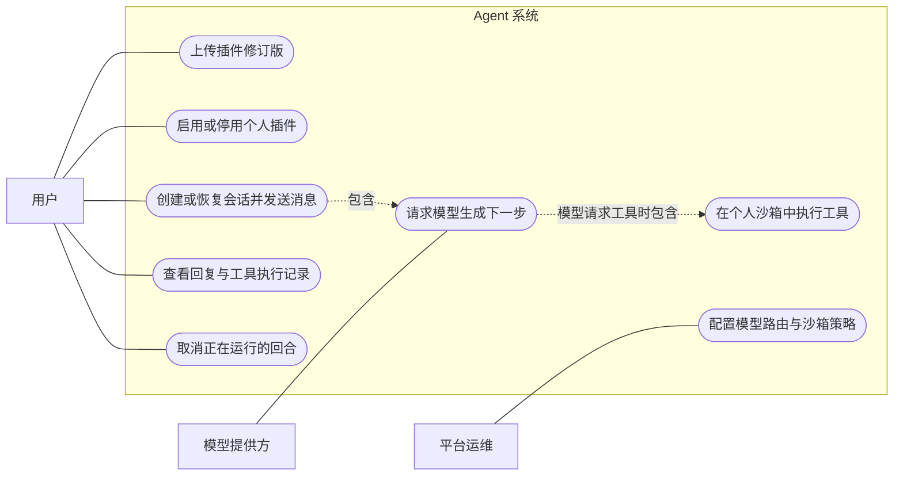
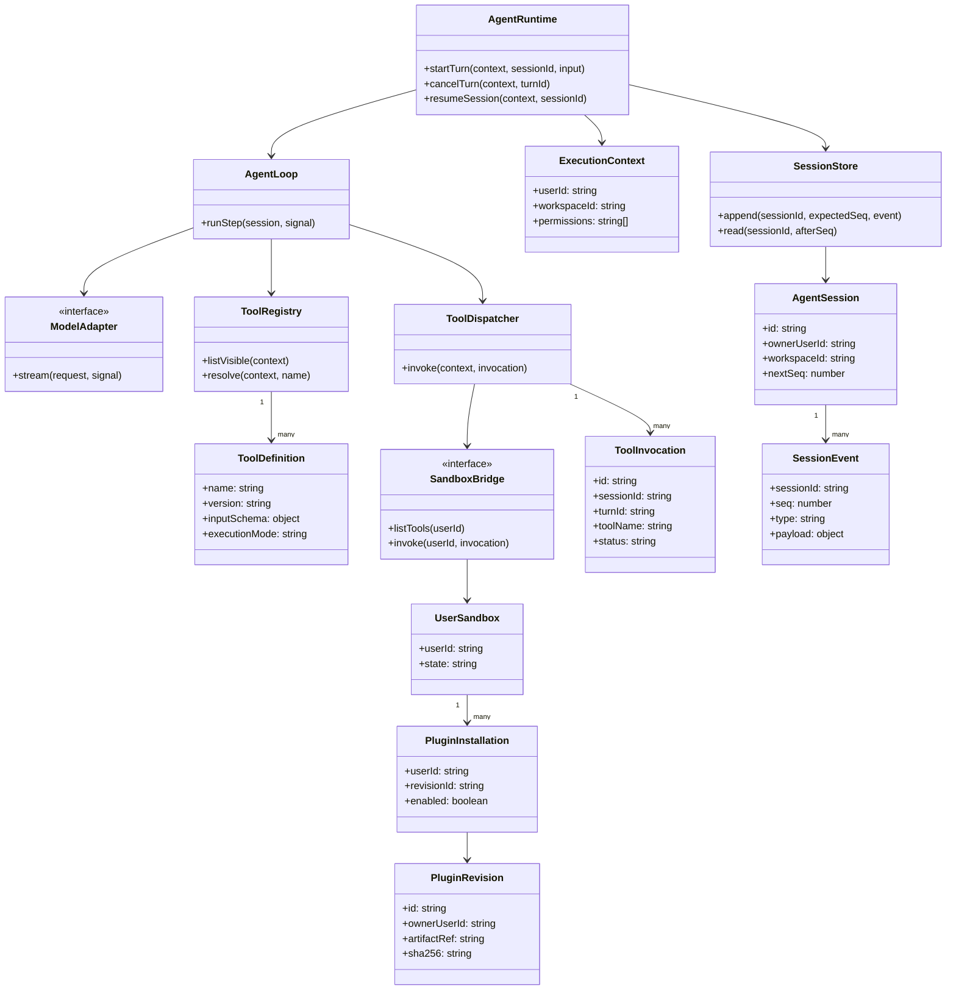
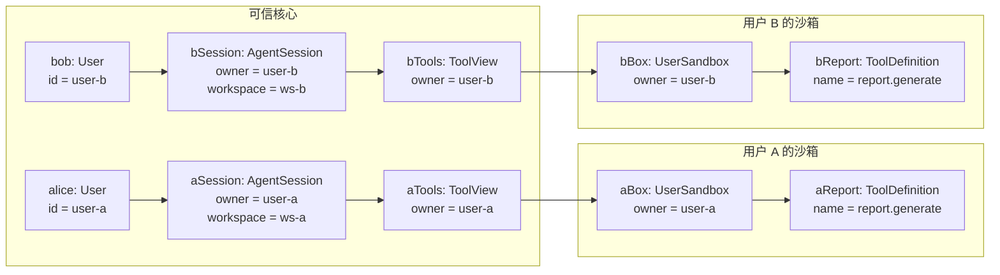

# 多用户 Agent Harness 设计

状态：待评审。本文描述拟实现的架构；仓库目前仍是目录骨架，图中的服务、表和接口均未实现。

## 目标与范围

在服务器上运行可持续对话、调用工具的 Agent。Harness 的服务注入、插件生命周期与事件扩展使用上游开源 `cordis`；Agent 循环、会话事件、模型适配和工具执行由本项目实现。用户可以上传并运行自己的 Cordis 插件代码，每位用户的插件与服务实例相互隔离。

第一阶段交付一个可验证的闭环：创建或恢复会话、接收消息、流式调用模型、执行用户插件提供的工具、保存事件、取消与失败恢复。知识库检索、业务插件目录、团队共享插件、子 Agent、插件热重载和可视化插件市场不在第一阶段范围内。

## 核心决策

1. 可信 Agent 核心在 `packages/ai-runtime` 中实现，启动时创建 Cordis 根上下文。`apps/api` 验证身份和工作空间权限，向核心传入不可由客户端伪造的运行上下文。
2. 用户上传的代码只在该用户专属的隔离工作负载中执行。每个工作负载拥有独立的 Cordis 根上下文、插件树和服务实例。不同用户不共用插件进程；同一用户的多个会话可以复用自己的工作负载。
3. 可信核心与用户工作负载只通过受版本约束的进程间协议交换工具声明、调用和结果。用户代码不进入可信 Cordis 容器，不获得 PostgreSQL 连接、平台模型密钥或容器管理权限。
4. 会话采用 PostgreSQL 中的追加式事件日志。模型输入由事件投影得到；模型流中发送给客户端的内容必须先持久化。每个会话使用单调递增序号，保证重放顺序。
5. 工具调用先持久化请求，再派发。执行结果未知且可能有副作用时，记录为 `unknown` 并结束当前运行，不自动重试。
6. 首期在现有 monorepo 边界内扩展：Cordis 插件与协议实现留在 `ai-runtime`；`db` 管理表和迁移；`contracts` 只含公开请求、响应及事件类型；`apps/api` 可增加独立进程入口负责沙箱编排，不使 `ai-runtime` 依赖 NestJS。

`cordis` 版本在实现时固定到一个经过集成测试的发行版本。其上游 API 仍在演进，因此项目自身的服务和远程协议不直接暴露 Cordis 内部对象。

## Cordis 组合与扩展点

可信核心把会话存储、模型适配、提示词组装、工具注册与派发、Agent 循环分别装配为 Cordis 插件。插件通过明确的服务依赖获得能力；Agent 循环只依赖服务契约，允许以后替换循环实现。首期提供 `agent/pre-step`、`agent/request`、`tools/pre-execute`、`tools/result`、`session/event` 等类型化扩展事件：前置事件可以拒绝或调整一次操作，结果事件只观察已确定的事实。注册和监听随所属 Cordis 插件卸载而撤销。

每位用户的沙箱另有自己的 Cordis 根上下文。用户插件只装入该上下文，能依赖同一用户沙箱内获准提供的服务；可信核心的服务不通过 Cordis 对象跨进程暴露。平台插件由部署者安装，用户插件由用户上传，这两类插件不共享装载路径。

## 用例图

以下用 Mermaid 绘制用例关系；椭圆代表用例，外框代表本项目的 Agent 系统。



用户只能管理自己的插件安装。插件上传并不等于立即运行：系统先保存不可变修订版和摘要，启用时才在该用户的沙箱内装载。模型提供方只接收可信核心组装的请求。

## 运行流程泳道图

泳道按执行责任划分。此图使用 Mermaid 11.16 及以上版本的 `swimlane-beta` 语法。

```mermaid
swimlane-beta LR
    subgraph client [用户与 Web]
        send(["发送消息"])
        receive["接收已持久化的回复片段"]
        cancel(["请求取消"])
        viewEnd(["查看本轮最终状态"])
    end

    subgraph api [API]
        authorize["验证身份和工作空间权限"]
        forward["转发流式片段"]
        authorizeCancel["鉴权并转发取消请求"]
        reportEnd["返回最终状态"]
    end

    subgraph core [Agent 核心]
        openSession["加载或创建会话"]
        startTurn["记录回合开始和用户消息"]
        assemble["投影事件并组装提示词与工具清单"]
        persistOutput["保存模型输出；有可见片段才推送"]
        decide{"模型输出类型？"}
        complete["记录最终回复和回合完成"]
        validate["校验工具、参数、权限与预算"]
        recordRequest["记录工具请求"]
        recordStarted["收到开始确认后记录执行开始"]
        outcome{"工具结果状态？"}
        succeeded["记录工具成功"]
        failed["记录工具明确失败"]
        unknown["记录结果未知并结束本轮"]
        budget{"步骤或时间预算耗尽？"}
        limit["记录本轮失败及原因"]
        stop["停止派发并结算在途调用，记录取消"]
    end

    subgraph model [模型服务]
        generate["流式生成回复或工具请求"]
    end

    subgraph sandbox [该用户的插件沙箱]
        accept["确认接收工具调用"]
        execute["执行工具并返回结果"]
    end

    send --> authorize --> openSession --> startTurn --> assemble --> generate
    generate --> persistOutput --> decide
    persistOutput -.->|有可见片段| forward --> receive
    decide -->|最终回复| complete --> reportEnd --> viewEnd
    decide -->|工具请求| validate --> recordRequest --> accept --> recordStarted --> execute --> outcome
    outcome -->|成功| succeeded --> budget
    outcome -->|明确失败| failed --> budget
    outcome -->|结果未知| unknown --> reportEnd
    budget -->|否| assemble
    budget -->|是| limit --> reportEnd
    cancel --> authorizeCancel --> stop --> reportEnd
```

取消可在模型流或工具执行期间到达：核心停止后续派发，保留已持久化并已展示的内容，并记录 `turn.cancelled`。工具调用结果若已确定，仍需写入对应结果；已派发但无法确认结果的调用写入 `tool.unknown`。流式内容按有序片段落库后再发送，客户端可用事件序号去重并在重连后补齐。

首期事件词汇固定为 `turn.started`、`user.message`、`step.started`、`assistant.chunk`、`assistant.completed`、`tool.requested`、`tool.started`、`tool.succeeded`、`tool.failed`、`tool.unknown`、`step.finished`，以及互斥的 `turn.finished`、`turn.failed`、`turn.cancelled`。每个工具请求最终恰有一个成功、失败或未知结果；每个回合最终恰有一个结束事件。模型输入投影读取这些事件，不维护另一份独立消息历史。

## 类图

类图表示拟实现的核心接口和持久化实体，方法签名是设计契约，不对应当前代码。



`AgentRuntime` 是面向 API 的少量稳定入口；核心内部通过 Cordis 服务组合 `SessionStore`、`ModelAdapter`、`ToolRegistry` 和 `ToolDispatcher`。`PluginRevision` 是不可变代码包；`PluginInstallation` 表示某位用户是否启用该修订版。工具定义在可信核心中按用户命名空间登记，并保存来源修订版与沙箱身份；名称相同的工具不会跨用户合并。

## 对象图：两个用户的实例快照

对象图展示一个时刻的实例及链接，不代表类之间的全部可能关系。



这两个同名工具是不同实例。可信核心从经过认证的 `userId` 生成工具视图和派发目标；不接受模型、插件或客户端传入的用户身份作为授权依据。工作空间资源访问另外按 `workspaceId` 校验，用户隔离不能替代工作空间授权。

## 跨进程工具契约

- 沙箱启动后，通过桥接协议报告工具名、版本、输入 JSON Schema、执行模式（默认串行；明确声明安全的工具可并行）和所属插件修订版。可信核心校验名称冲突、协议版本、模式和 schema 后再加入该用户的工具视图。
- `ToolInvocation` 由可信核心生成，包含调用 ID、会话 ID、回合 ID、工具版本、参数和截止时间。桥接层依据可信会话归属选定用户沙箱，不让插件选择目标用户。
- 沙箱先确认接收调用，核心持久化 `tool.started` 后再允许执行；没有收到确认的调用不标记为已开始。执行断连时仍按实际可确认的结果决定 `failed` 或 `unknown`。
- 返回值是可序列化的成功结果或结构化错误。模型仅看到经过大小限制和敏感内容过滤的结果；服务端事件与审计元数据同样不记录平台密钥或原始凭据。
- 远程接口不传递 Cordis `Context`、数据库客户端、平台密钥或原始容器控制句柄。插件若需要平台能力，必须通过另行定义并授权的能力接口调用。
- 每个用户的沙箱内可同时装载多个个人插件；它们可以按 Cordis 依赖关系使用该用户沙箱内的服务，但不能发现其他用户的服务。

## 持久化、隔离与失败语义

PostgreSQL 保存用户、会话、插件修订版元数据、安装关系、工具调用和会话事件。原始插件包放在对象存储，数据库仅保存引用和摘要。会话事件以 `(session_id, seq)` 唯一约束按序追加；会话、安装和调用记录都带 `owner_user_id`，涉及业务数据时还带 `workspace_id`。API 与 runtime 在每次读写时执行归属和工作空间校验。Redis 可以协调运行队列和短期租约，但不作为会话事实来源。

可信服务负责创建沙箱并选择用户；插件代码只在沙箱内执行。沙箱使用非特权身份、只读基础文件系统、受限临时目录、默认拒绝外部网络、无平台密钥、CPU/内存/执行时间配额，不挂载宿主机控制接口。它只能通过专用本地通道与 `SandboxBridge` 通信。容器编排权限只交给可信的编排进程，不暴露给面向公网的 API 或插件进程。具体容器技术由部署适配器实现，Agent 与工具协议不依赖 Docker 或 Kubernetes API。容器隔离仍需部署层安全验证；面向不可信公众代码上线前，应评估更强的沙箱运行时。

同一会话同一时刻只允许一个活动回合，避免事件序号和模型上下文竞态。同一用户的不同会话可以并行，工具调用默认在该用户沙箱内串行；工具声明并行安全后才可并行。首期默认每回合最多 12 个模型步骤、24 次工具调用、180 秒，单次工具最多 30 秒；服务端配置可以收紧这些上限。到限时写入 `turn.failed`，不继续派发。

模型请求失败可在未产生外部副作用时按受限退避重试。沙箱明确返回的工具错误可作为工具结果交给模型，由模型决定下一步。已派发但无法确认完成情况的工具调用记为 `tool.unknown`，停止本轮并向用户展示需要检查的状态；恢复会话不自动重放它。

## 验收与验证

1. 使用模拟模型与两个真实隔离沙箱完成“用户消息 → 工具调用 → 工具结果 → 最终回复”闭环，并能从持久化事件重放同样的会话状态。
2. A 和 B 上传同名工具，A 的工具清单与调用只访问 A 的实例；伪造请求体、模型输出或插件返回中的 `userId` 不改变派发目标。
3. 用户 A 的沙箱崩溃、超时或被销毁时，B 的会话仍能运行；A 的运行写入确定的失败或未知结果，插件服务随沙箱结束清理。
4. 取消与客户端重连后，已展示内容能通过事件序号恢复且不重复；同一会话的并发回合被拒绝或排队，不出现乱序事件。
5. 结果未知的有副作用工具不自动重试；CPU、内存、时间与网络限制在沙箱部署测试中得到验证。

## 设计依据

- [DeepSeek Harness 架构](https://github.com/deepseek-ai/deepseek-harness/blob/master/docs/architecture.zh.md)：Cordis 服务、事件与可撤销插件注册的参考。
- [DeepSeek Agent loop](https://github.com/deepseek-ai/deepseek-harness/blob/master/packages/core/agent-loop/README.md)：模型—工具循环、取消与未知工具结果的参考。
- [Cordis 项目](https://github.com/cordiverse/cordis)：拟采用的上游框架；其 API 仍在演进。
- [Cordis Context API](https://github.com/deepseek-ai/deepseek-harness/blob/master/docs/cordis-api/context.md)：服务作用域机制。作用域用于组织实例和生命周期，不是执行不可信代码的安全边界。
- [Docker 安全说明](https://docs.docker.com/engine/security/)与[容器资源限制](https://docs.docker.com/engine/containers/resource_constraints)：隔离部署所需的权限和资源边界。
