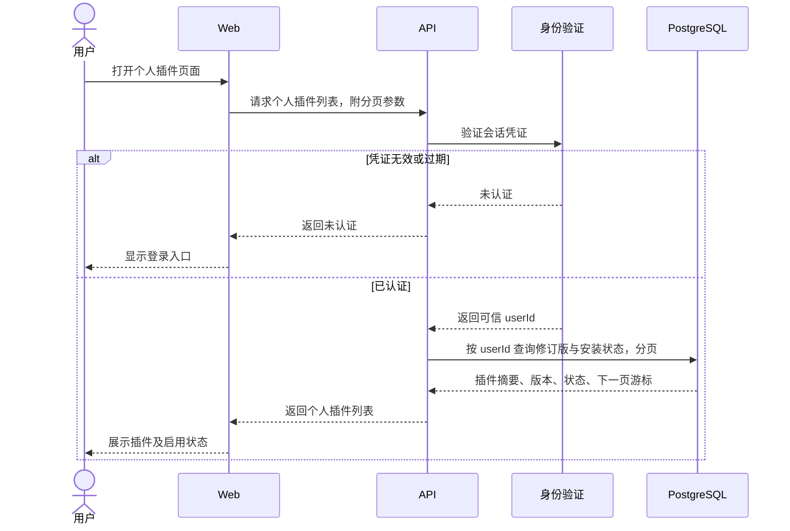
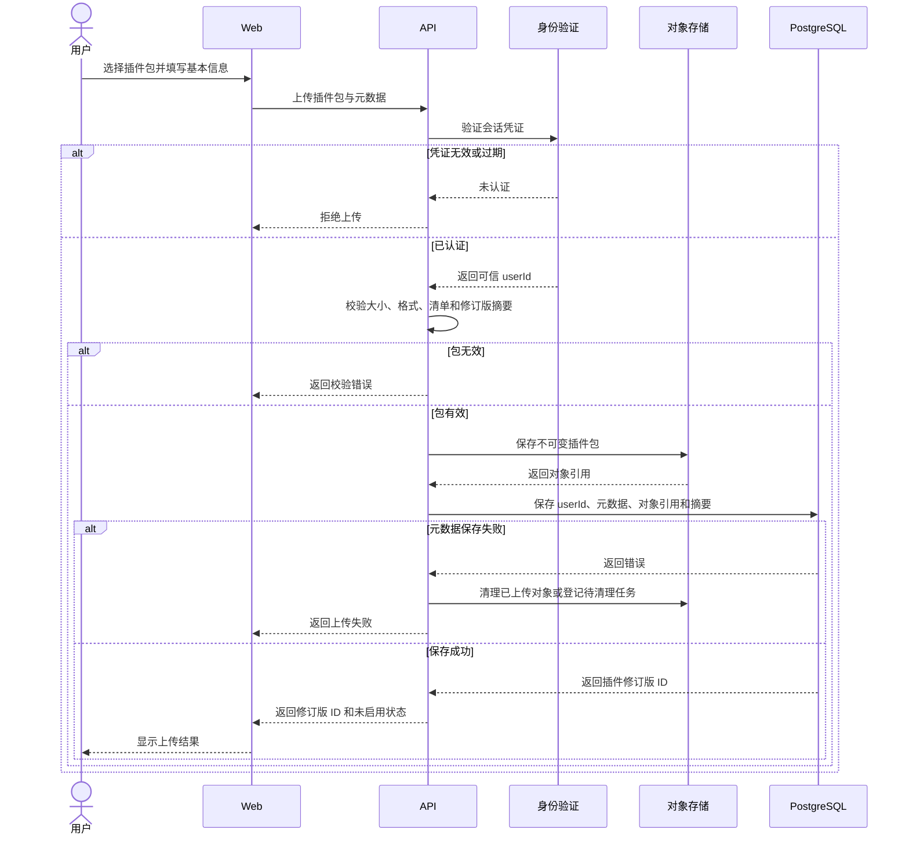
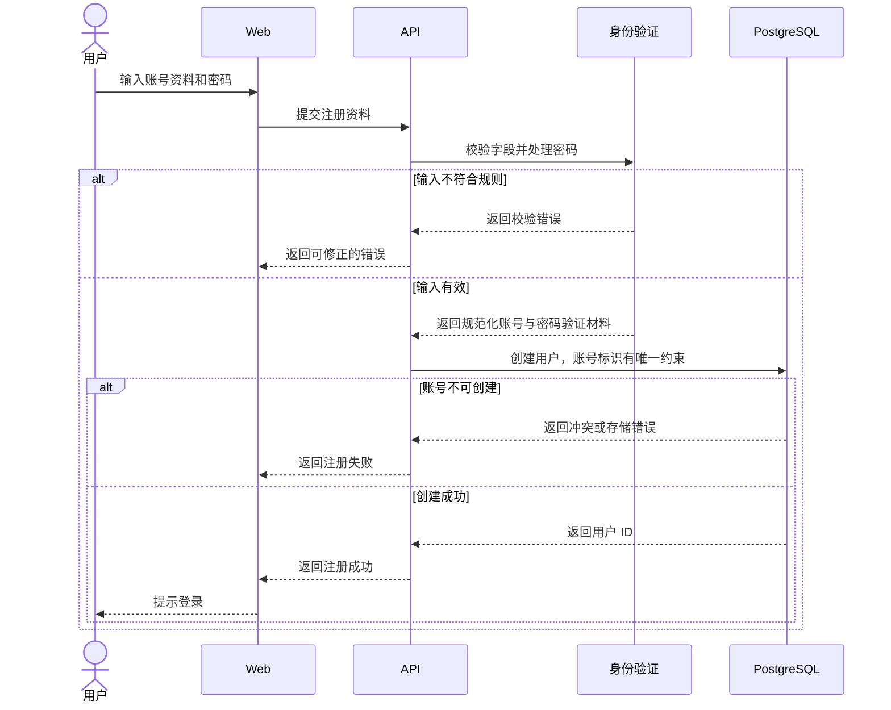
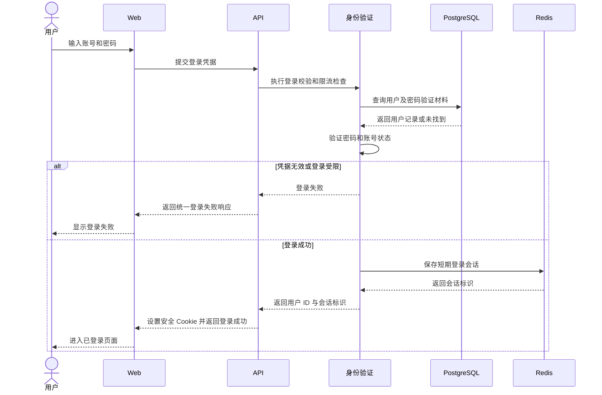
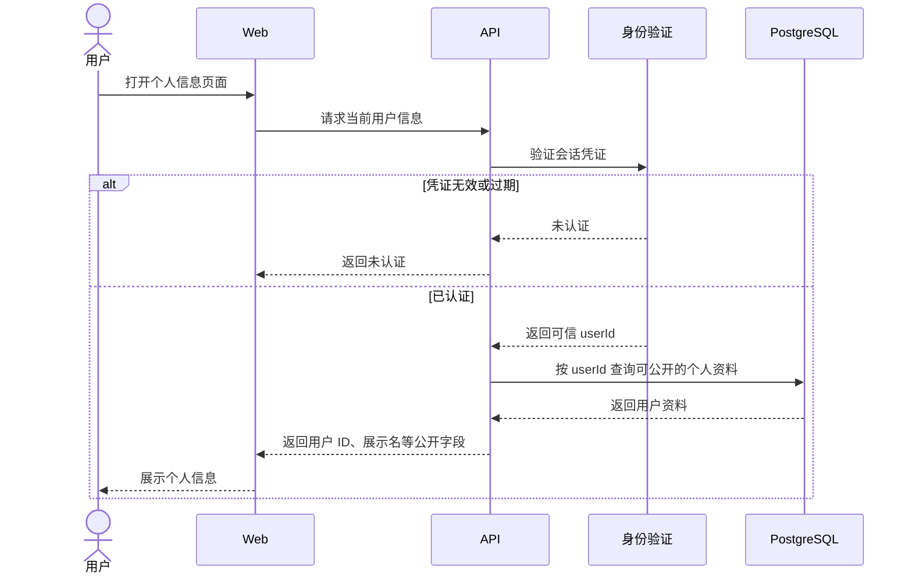
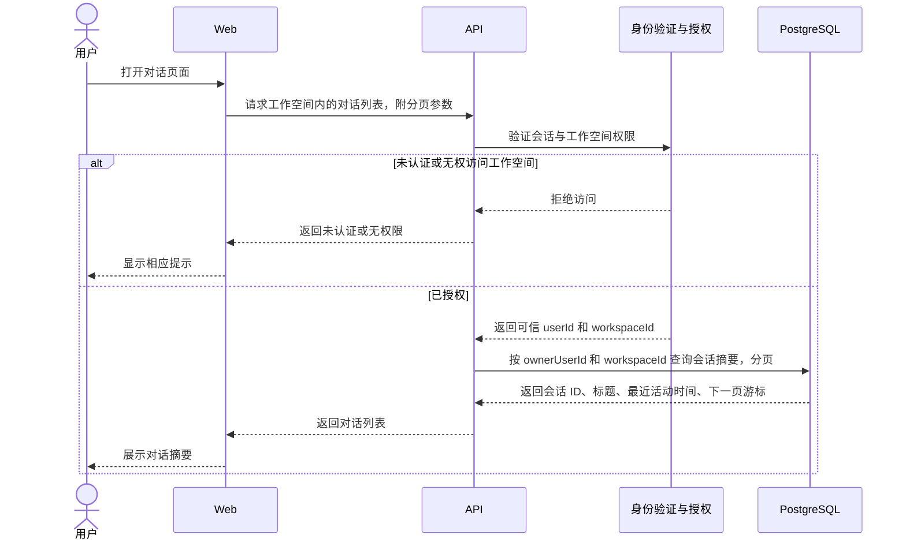

# Agent 平台功能时序图

状态：待评审。本文描述拟实现的交互，仓库中的 API、存储和页面目前尚未实现。每个操作使用一张独立的 Mermaid `sequenceDiagram`；Agent 执行回合的时序图见[多用户 Agent Harness 设计](./2026-10-01-agent-harness-design.md#运行流程时序图)。

## 范围和约定

- “插件列表”指当前用户上传的个人插件修订版及启用状态。列表由 API 按已认证用户过滤，使用分页；用户标识不从查询参数取得。
- “对话列表”指当前用户在当前工作空间内可访问的会话摘要，按最近活动时间分页。列表读取 PostgreSQL 中的会话元数据；完整消息从会话事件读取。
- 身份验证首版按账号密码设计。API 保存密码验证材料，不保存明文密码；成功登录后签发服务端会话凭证，浏览器通过 `Secure`、`HttpOnly`、`SameSite` Cookie 携带。Redis 保存短期登录会话，PostgreSQL 保存用户主记录。
- 图中的“失败”表示该操作的直接失败分支；具体错误码、字段校验和页面文案在接口设计时确定。注册成功不自动登录。

## 1. 用户获取插件列表

列表只返回展示所需的元数据，不返回插件包、服务端凭据或其他用户的插件。

## 2. 用户上传插件

上传成功只产生不可变修订版；启用和在个人沙箱装载属于后续独立操作。API 对插件包做结构校验，不运行其中的代码。

## 3. 用户注册

账号标识唯一性由数据库约束保证；密码处理在服务端完成。

## 4. 用户登录

登录失败响应不区分“账号不存在”和“密码错误”。会话标识只由服务端签发，前端脚本不读取 Cookie 内容。

## 5. 用户获取个人信息

响应不包含密码验证材料、会话标识或插件凭据。

## 6. 用户获取对话列表

列表查询同时限定用户和工作空间；客户端提供的会话 ID 或工作空间 ID 不能代替服务端授权检查。

## 核对点

1. 未登录用户不能读取插件列表、个人信息或对话列表，也不能上传插件。
2. 用户 A 的插件及对话不会出现在用户 B 的列表；切换工作空间后重新验证会话列表范围。
3. 上传失败不会留下可启用的插件修订版；上传成功不会执行插件代码。
4. 注册、登录和获取个人信息的响应不泄露密码验证材料或服务端凭据。

## 参考

- [OWASP Session Management Cheat Sheet](https://cheatsheetseries.owasp.org/cheatsheets/Session_Management_Cheat_Sheet.html)：会话 Cookie 和服务端会话管理。
- [OWASP Authentication Cheat Sheet](https://cheatsheetseries.owasp.org/cheatsheets/Authentication_Cheat_Sheet.html)：认证处理。
- [OWASP File Upload Cheat Sheet](https://cheatsheetseries.owasp.org/cheatsheets/File_Upload_Cheat_Sheet.html)：上传文件校验和隔离存储。
