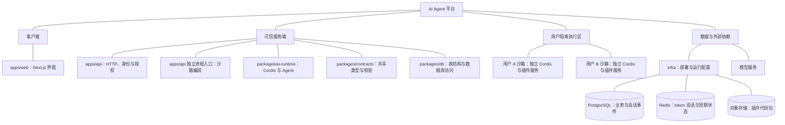

# 第一阶段技术方案

状态：设计草案。更新日期：2026-10-02。范围对应[需求清单](./requirements-checklist.md)的 P0 项与[项目总体 PRD](./prd/project.md)。仓库目前只有 workspace 骨架和工程工具；下文业务接口、数据库表和沙箱尚未实现。“拟采用”版本须经集成测试后写入清单并精确锁定。

## 1. 整体架构结构图

图中连线仅表示层级归属，不表示执行顺序。Web 只依赖公开契约并调用 API；API 负责身份和授权，runtime 负责 Agent 执行，编排入口管理用户沙箱。PostgreSQL 保存业务主记录与会话事件，Redis 保存短期状态，对象存储保存插件代码包；每位用户的沙箱拥有独立 Cordis 根上下文和插件服务。请求与数据流见[Agent 时序图](./superpowers/specs/2026-10-01-agent-harness-design.md#运行流程时序图)及各功能 PRD。

## 2. 技术选型表

| 类别         | 选型与阶段                                                   | 理由                                                                 |
| ------------ | ------------------------------------------------------------ | -------------------------------------------------------------------- |
| 语言与运行时 | TypeScript；Node.js 24 LTS（拟采用）                         | 与现有 workspace 一致，Web、API 和 runtime 可共用类型契约。          |
| 包管理       | pnpm 11.5.2（仓库已有）                                      | 已写入根目录配置，用单个锁文件管理 workspace。                       |
| Web          | React 19 + Next.js 16（拟采用）                              | 符合既定 React/Next.js 目录职责，支持服务器部署与交互式聊天。        |
| HTTP API     | NestJS 12（拟采用）                                          | 符合既定 API 边界，模块与守卫便于组织身份、上传和管理接口。          |
| Agent 框架   | 上游开源 Cordis 4.0.0-rc.10 候选（拟采用）                   | 负责服务注入与插件生命周期；Agent loop、事件和工具协议由本项目实现。 |
| 主记录       | PostgreSQL 17（拟采用）                                      | 归属关系、不可变修订版和会话事件需要事务、约束与稳定排序。           |
| 短期状态     | Redis 7.4（拟采用）                                          | 保存可撤销的 token 会话及运行协调状态。                              |
| 代码包       | S3 兼容对象存储（拟采用）                                    | 上传包独立保存，数据库仅保留对象引用与摘要。                         |
| 用户沙箱     | Linux 每用户独立容器；Docker Engine 29 候选（拟采用）        | 为用户代码提供独立进程、文件系统、网络与资源限制。                   |
| 关键库       | `pg` 8、`redis` 6、`@aws-sdk/client-s3` 3、`zod` 4（拟采用） | 分别负责数据库、短期会话、对象存储和边界数据校验。                   |

### 重大选型对比

| 选择                          | 为什么采用                                               | 为什么不用备选方案                                                                                                    |
| ----------------------------- | -------------------------------------------------------- | --------------------------------------------------------------------------------------------------------------------- |
| 上游 Cordis + 自研 Agent loop | 保留已确认的插件生命周期，同时由项目控制事件和执行语义。 | 整套 DeepSeek Harness 会引入额外产品结构；完全自写插件容器需要重做服务注入和卸载。Cordis 4 仍是候选，先做兼容性验证。 |
| 每用户独立沙箱                | 满足用户上传代码和服务实例隔离。                         | 同进程 Cordis Context、`worker_threads` 和 Node.js `vm` 均不能作为不可信代码的隔离边界。                              |
| PostgreSQL 主记录             | 归属关系、事件序号和安装状态可由事务与约束维护。         | MongoDB 虽能存事件文档，第一阶段仍需额外处理关系完整性与一致性。                                                      |
| Redis 服务端 token 会话       | 直接支持过期、撤销和主动失效。                           | 纯无状态 JWT 要额外设计撤销机制；首期 PRD 已按短期服务端会话描述。                                                    |
| S3 兼容对象存储               | 上传包与元数据分别保存，便于不可变对象管理。             | 将代码包存为 PostgreSQL 大字段会增大主库和备份负担。                                                                  |
| NestJS 12                     | 与项目既定 NestJS 方向一致，且适合模块化 HTTP API。      | 单独使用 Fastify 需要另建身份与管理接口组织方式；NestJS 12 的代价是同步升级当前 TypeScript 5.9.3。                    |

## 3. 模块设计与边界

| 模块                  | 一句话职责                                             | 分工边界                                                            |
| --------------------- | ------------------------------------------------------ | ------------------------------------------------------------------- |
| `apps/web`            | 展示身份、插件与聊天页面，提交请求并消费有序事件流。   | 只依赖 `contracts`，不连接数据库或持有平台密钥。                    |
| `apps/api`            | 验证 token 和工作空间权限，处理 HTTP、上传与插件管理。 | 将可信 `ExecutionContext` 交给 runtime；不执行用户代码。            |
| `apps/api` 编排入口   | 创建、复用和停止用户沙箱，装载已授权插件修订版。       | 独立进程持有容器管理权限，公网 API 与沙箱均不持有。                 |
| `packages/ai-runtime` | 用 Cordis 组合模型、事件、Agent loop、工具视图与桥接。 | 可经 `db` 访问数据，但始终按可信用户和工作空间过滤；不依赖 NestJS。 |
| `packages/db`         | 定义 PostgreSQL 表、迁移与共享访问基础。               | 不负责 HTTP 身份验证；提供可限定归属范围的访问方式。                |
| `packages/contracts`  | 定义公开请求、响应、事件与校验规则。                   | 不包含数据库客户端、密钥、容器句柄或 Cordis Context。               |
| `infra`               | 配置 PostgreSQL、Redis、对象存储和沙箱部署。           | 只放部署和示例配置，不放业务代码。                                  |

API 从 token 得到 `userId`，再验证目标资源和工作空间；客户端参数、模型输出及插件返回值不能覆盖该身份。每位用户的沙箱有独立 Cordis 根上下文，只通过受版本约束的进程间协议暴露工具。上传成功仅保存修订版，启用才装载。已派发且结果未知的有副作用工具记录 `tool.unknown`，不自动重试。具体状态见[Agent 模块 PRD](./prd/modules/agent.md)和[插件模块 PRD](./prd/modules/plugins.md)。

## 4. 数据模型

| 核心实体                   | 主要字段                                                        | 关系与约束                                              |
| -------------------------- | --------------------------------------------------------------- | ------------------------------------------------------- |
| `User`                     | `id`、`accountKey`、`displayName`、`passwordVerifier`           | 规范化账号标识唯一；拥有插件修订版和会话。              |
| `Workspace` / `Membership` | `workspaceId`、`userId`、`role`                                 | 工作空间关联成员；创建与切换规则待功能 PRD 定稿。       |
| `TokenSession`             | `tokenId`、`userId`、`expiresAt`、`revokedAt`                   | Redis 短期记录；过期或撤销后不能认证。                  |
| `PluginRevision`           | `id`、`ownerUserId`、`name`、`version`、`sha256`、`artifactRef` | 修订版不可变；对象引用指向代码包。                      |
| `PluginInstallation`       | `userId`、`revisionId`、`enabled`、`loadState`                  | 用户与修订版的安装关系；启用状态不修改包。              |
| `Conversation`             | `id`、`ownerUserId`、`workspaceId`、`title`、`lastActivityAt`   | 一个会话有多个回合；同一时间仅一个活动回合。            |
| `Turn` / `SessionEvent`    | `turnId`、`sessionId`；事件含 `seq`、`type`、`payload`          | `(sessionId, seq)` 唯一递增；回合最终只有一个结束事件。 |
| `ToolInvocation`           | `id`、`turnId`、`revisionId`、`toolName`、`status`              | 关联回合与工具来源；最终结果为成功、失败或未知之一。    |

除 `TokenSession` 在 Redis、代码包在对象存储外，主记录均在 PostgreSQL。会话、安装与工具调用都保留用户归属；涉及工作空间的记录还保留 `workspaceId`。列表用最近活动时间和 ID 稳定排序并采用游标分页。模型输入由事件投影得到，不另存一份独立消息历史。字段名为草案，以迁移和类型定义为准。

## 5. 接口清单

路径目前为规划，尚无可访问端点。字段、错误码与流式事件结构先参照下表的功能文档，随后在 `packages/contracts` 固化请求、响应和事件类型。插件启停、Agent 回合与事件读取仍需补 L3 PRD；在补齐前，模块文档只定义边界，不视为完整字段契约。

| 方法   | 路径草案                                  | 一句话用途                                 | 字段依据                                                                          |
| ------ | ----------------------------------------- | ------------------------------------------ | --------------------------------------------------------------------------------- |
| `POST` | `/auth/register`                          | 创建唯一账号。                             | [注册 PRD](./prd/features/register.md)                                            |
| `POST` | `/auth/login`                             | 验证凭据并返回 access token。              | [登录 PRD](./prd/features/login.md)                                               |
| `GET`  | `/users/me`                               | 凭 token 获取当前用户公开资料。            | [个人信息 PRD](./prd/features/get-profile.md)                                     |
| `GET`  | `/plugins`                                | 分页获取本人插件修订版与启用状态。         | [插件列表 PRD](./prd/features/list-plugins.md)                                    |
| `POST` | `/plugins`                                | 上传代码包并创建未启用修订版。             | [上传插件 PRD](./prd/features/upload-plugin.md)                                   |
| `POST` | `/plugins/{revisionId}/enable`            | 验证归属后启用并装载个人插件。             | [插件模块 PRD](./prd/modules/plugins.md)，待补 L3                                 |
| `POST` | `/plugins/{revisionId}/disable`           | 停用插件并撤销后续工具可见性。             | [插件模块 PRD](./prd/modules/plugins.md)，待补 L3                                 |
| `GET`  | `/workspaces/{workspaceId}/conversations` | 分页获取当前用户在已授权工作空间中的对话。 | [对话列表 PRD](./prd/features/list-conversations.md)                              |
| `POST` | `/workspaces/{workspaceId}/turns`         | 创建或续接会话回合并流式返回事件。         | [Agent 模块 PRD](./prd/modules/agent.md)，待补 L3                                 |
| `POST` | `/turns/{turnId}/cancel`                  | 取消当前用户有权操作的回合。               | [Agent 模块 PRD](./prd/modules/agent.md)，待补 L3                                 |
| `GET`  | `/conversations/{sessionId}/events`       | 按事件序号读取事件以供重连补齐。           | [Agent 技术设计](./superpowers/specs/2026-10-01-agent-harness-design.md)，待补 L3 |

受保护接口均携带登录返回的 `Authorization: Bearer <token>`。API 从服务端 token 会话确定用户，仍须单独校验插件、会话及工作空间归属。

## 6. 依赖清单

“拟采用”依赖尚未安装，版本范围是实施约束。安装时锁定精确 patch 和 `pnpm-lock.yaml`；服务镜像固定可复现标签或摘要。升级前逐项核对兼容性与测试。

| 依赖                                       | 使用位置                | 版本要求 / 当前状态                                                                          | 升级核对点                                             |
| ------------------------------------------ | ----------------------- | -------------------------------------------------------------------------------------------- | ------------------------------------------------------ |
| Node.js                                    | Web、API、runtime、沙箱 | 拟采用 24 LTS；使用 Nest CLI 生成器时至少 24.15。                                            | ESM、构建、核心与沙箱 Node 版本一致性。                |
| pnpm                                       | 全仓库                  | 已声明 11.5.2；锁文件已有。                                                                  | workspace 解析及锁文件变化。                           |
| TypeScript                                 | 全仓库                  | 已安装 5.9.3；采用 NestJS 12 前升级到兼容的 6.x。                                            | `contracts` 导出、Nest 编译和跨包类型检查。            |
| Next.js / React / React DOM                | `apps/web`              | 拟采用 Next 16.x、React/React DOM 19.x；未安装。                                             | 框架与 React 适配、聊天流和构建。                      |
| NestJS 核心及平台适配器                    | `apps/api`              | 拟采用同一 12.x 系列；未安装。                                                               | 全部 `@nestjs/*` 主版本一致，守卫、上传和 ESM。        |
| Cordis                                     | 核心及每用户沙箱        | 候选 `cordis@4.0.0-rc.10`，须精确锁定并做集成试验；未安装。                                  | 核心/沙箱版本一致，服务注入与插件卸载。                |
| `pg`、`redis`、`@aws-sdk/client-s3`、`zod` | DB、API、contracts      | 拟采用 8.x、6.x、3.x、4.x；未安装。                                                          | 连接池、token TTL、对象清理和协议校验。                |
| PostgreSQL                                 | 主记录与会话事件        | 拟采用 17.x；部署时固定受支持的 minor。                                                      | 迁移、唯一约束、分页索引和事件重放。                   |
| Redis Open Source                          | token 会话与短期协调    | 拟采用 7.4.x 扩展维护系列，与候选 `redis` 6 客户端的官方支持范围一致。                       | TTL、撤销和客户端兼容。                                |
| S3 兼容对象存储                            | 插件包                  | 兼容 S3 API `2006-03-01` 的对象写入、读取和删除；服务商及部署版本待选，选定后固定。          | 摘要一致性、访问权限与失败清理。                       |
| Docker Engine / Linux 宿主                 | 用户沙箱                | Docker 29.8.2 候选；宿主须支持非特权运行与资源、网络限制。                                   | CPU/内存配额、网络默认拒绝、宿主控制接口不可见。       |
| 模型服务                                   | Agent 生成              | 供应方与 API 版本待定；适配器须支持流式回复及工具请求。                                      | 超时、取消、工具格式和重试语义。                       |
| 内部 workspace 包                          | Web、API、runtime       | `@ai-harness/contracts`、`db`、`ai-runtime` 当前包版本均为 `0.0.0`，引用使用 `workspace:*`。 | 遵守[项目协作说明](../AGENTS.md)的依赖方向和公开入口。 |

版本依据：[Node.js 发布状态](https://nodejs.org/en/about/previous-releases)、[Next.js 安装要求](https://nextjs.org/docs/app/getting-started/installation)、[NestJS 运行要求](https://docs.nestjs.com/first-steps)与[版本迁移](https://docs.nestjs.com/migration-guide)、[Cordis 上游包](https://github.com/cordiverse/cordis/blob/main/packages/core/package.json)、[PostgreSQL 支持周期](https://www.postgresql.org/support/versioning/)、[Redis 版本维护](https://redis.io/docs/latest/operate/oss_and_stack/install/version-mgmt/)与[客户端支持范围](https://www.npmjs.com/package/redis)、[S3 客户端与 API 版本](https://www.npmjs.com/package/@aws-sdk/client-s3)、[Docker Engine 29 发布说明](https://docs.docker.com/engine/release-notes/29/)。
